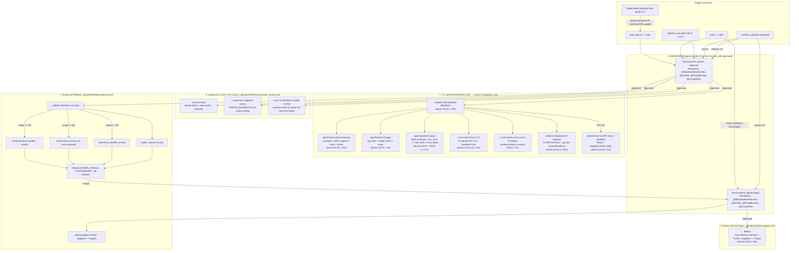

# `Boostao/vpro` GitHub Actions, CODEOWNERS & Approval Gates

This directory holds the continuous integration, GitHub Pages deployment, cross-platform release packaging, upstream security/CRAN canary checks, Dependabot configuration, and repository ownership rules for **`Boostao/vpro` (`VPro` 2.0)**.

---

## 1. CODEOWNERS & Runner-Gating Approval Policy

To prevent unapproved workflow runs from consuming GitHub Actions runner minutes on pushes, PRs, manual dispatches, or scheduled crons:

- **[`CODEOWNERS`](./CODEOWNERS)** assigns global ownership (`*`) to **`@Boostao/boostao-dev`**, **`@meztez`**, **`@FrankBornais`**, and **`@nic-gauthier`**.
- **Protected GitHub Environments (`actions-approval` & `github-pages`)** require reviewer approval from `@Boostao/boostao-dev` (or any Boostao org member listed above) **before a runner VM is provisioned**. Pending jobs stay in `Waiting` state with **0 runner minutes billed** until approved.
- **Fork PR Contributor Approval Policy** is set to `all_external_contributors` so external fork pull requests require maintainer approval prior to running workflows.

### How Each Workflow Is Gated

| Workflow | Gated Entry Job(s) | Protected Environment | Effect Before Approval |
|---|---|---|---|
| [`workflows/ci.yml`](./workflows/ci.yml) | `changes` (root fan-out job) | `actions-approval` | Entire CI pipeline waits before spinning up any runner. One approval releases only the path-filtered jobs. |
| [`workflows/pages.yml`](./workflows/pages.yml) | `deploy` | `github-pages` | Pages build and deploy wait before provisioning `ubuntu-24.04`. |
| [`workflows/release.yml`](./workflows/release.yml) | `validate` (root job) + `deploy-pages` | `actions-approval` (start) / `github-pages` (deploy) | Manual releases pause before Windows/macOS/Linux/R build matrices spin up. |
| [`workflows/upstream-canary.yml`](./workflows/upstream-canary.yml) | `security-audit`, `r-upstream-suggests-canary`, `cross-os-desktop-compile-smoke` | `actions-approval` | Weekly Monday canary runs pause until approved (approve all 3 environments at once in "Review deployments"). |

### How to Approve (or Un-Gate Later)

1. **In GitHub Web UI**: Open the waiting workflow run under the **Actions** tab $\rightarrow$ click **Review deployments** $\rightarrow$ check the environment(s) $\rightarrow$ click **Approve and deploy**.
2. **Via `gh` CLI**:
   ```bash
   # List pending deployments for a waiting run
   gh api repos/Boostao/vpro/actions/runs/<RUN_ID>/pending_deployments

   # Approve pending deployments
   gh api --method POST repos/Boostao/vpro/actions/runs/<RUN_ID>/pending_deployments \
     -F "environment_ids[]=<ENV_ID>" -f state=approved -f comment="Approved by CODEOWNER"
   ```
3. **To un-gate later**: Remove `environment: actions-approval` from the workflow YAML files (and optionally clear required reviewers on the `actions-approval` / `github-pages` environments in **Settings $\rightarrow$ Environments**).

---

## 2. Workflow & Automation Inventory

| File | Name | Triggers | Jobs & Runners | Responsibilities |
|---|---|---|---|---|
| [`workflows/ci.yml`](./workflows/ci.yml) | **CI** | `pull_request` $\rightarrow$ `main`<br>`push` $\rightarrow$ `main`<br>(`cancel-in-progress: true`) | 1. `changes` (`ubuntu-24.04`)<br>2. `portal-and-scripts` (`ubuntu-24.04`)<br>3. `app-frontend` (`ubuntu-24.04`)<br>4. `app-backend` (`ubuntu-24.04` + `postgres:16`)<br>5. `r-cmd-check-linux` (`ubuntu-24.04` $\times$ R `release`, `4.4` + `postgres:16`)<br>6. `r-cmd-check-cross-os` (`windows-latest`, `macos-latest` $\times$ R `release`)<br>7. `rsidecar-integration` (`ubuntu-24.04`)<br>8. `website-dry-run` (`ubuntu-24.04`, PR only) | Path-filters both pushes and PRs via `dorny/paths-filter@v4`; verifies Go/Wails/WebGPU lockstep, strict brand assets, OKF markdown hygiene, and `help_bundle.json` / Wails TS bindings drift; runs Svelte 5 unit tests, `svelte-check`, and Vite build; runs Go `-race` + full Go backend test suite + `task linux:build`; runs `R CMD check --as-cran` across Linux/Windows/macOS against seeded PostgreSQL 16 `BECMaster`; validates Go $\leftrightarrow$ R sidecar contract; dry-runs unified `/` + `/r/` website on PRs. |
| [`workflows/pages.yml`](./workflows/pages.yml) | **Deploy GitHub Pages** | `push` $\rightarrow$ `main` touching `site/**`, `docs-src/**`, `scripts/**`, `r/**`, `app/resources/standards-2026-provenance.json`, or `pages.yml`<br>`workflow_dispatch` | 1. `deploy` (`ubuntu-24.04`) | Syncs `site/release-manifest.json` from published GitHub Releases, compiles `docs-src` $\rightarrow$ `help_bundle.json`, builds BC Gov release portal (`site/dist/`), builds `pkgdown` R documentation (`site/dist/r/`), verifies required assets and bidirectional links, and deploys to GitHub Pages. |
| [`workflows/release.yml`](./workflows/release.yml) | **Build and Release** | `workflow_dispatch` (`version`, `scope: full \| r-only`, `prerelease`, `draft`) | 1. `validate` (`ubuntu-24.04`)<br>2. `build-windows` (`windows-2022` $\times$ `amd64`, `arm64`)<br>3. `build-macos` (`macos-15-intel` universal)<br>4. `build-linux` (`ubuntu-24.04` `amd64`, `ubuntu-24.04-arm` `arm64`)<br>5. `build-r` (`ubuntu-24.04`)<br>6. `release` (`ubuntu-24.04`)<br>7. `deploy-pages` (`ubuntu-24.04`) | Validates SemVer & tag source commit; builds Windows EXE/ZIP/NSIS (`amd64`/`arm64`), macOS universal `.app`/DMG/ZIP, Linux deb/rpm/tar (`amd64`/`arm64`), and checked R SDK tarball (`vpro-r-sdk.tar.gz`); verifies PE/ELF/Mach-O headers and Windows system-only DLL imports (`../scripts/release.py`); publishes GitHub Release with `SHA256SUMS.txt` & `release-manifest.json`; re-downloads & verifies every uploaded byte; updates GitHub Pages. |
| [`workflows/upstream-canary.yml`](./workflows/upstream-canary.yml) | **Upstream & Cross-OS Canary** | Weekly `schedule` (`17 9 * * 1` — Mon 09:17 UTC)<br>`workflow_dispatch` | 1. `security-audit` (`ubuntu-24.04`)<br>2. `r-upstream-suggests-canary` (`ubuntu-24.04`)<br>3. `cross-os-desktop-compile-smoke` (`windows-2022`, `macos-15-intel`) | Checks Go/Wails/WebGPU lockstep, runs `govulncheck ./...` (with CGO/GTK4/WebKitGTK), runs `npm audit --omit=dev --audit-level=high`, runs `R CMD check --as-cran` with `_R_CHECK_FORCE_SUGGESTS_=true` against upstream `bcgov/climr` & CRAN, and smoke-compiles Windows & macOS CGO desktop binaries. |
| [`dependabot.yml`](./dependabot.yml) | **Dependabot Updates** | Monthly `schedule` (Mon 08:00 `America/Vancouver`) | GitHub Dependabot | Opens grouped monthly PRs for `github-actions`, `gomod` (`/app`, minor/patch, ignoring coupled `wails/v3` & `go-sqlite3`), and `npm` (`/app/frontend` `geospatial-webgpu` & `frontend-toolchain`, ignoring `@wailsio/runtime` & `typescript` semver-major until `svelte-check` supports TS 7). |

---

## 3. Architecture Diagrams

### Mermaid Flowchart



### ASCII Pipeline Overview

```text
========================================================================================================
EVENT / TRIGGER             APPROVAL GATE       WORKFLOW & JOBS                             DURATION
========================================================================================================
[1] pull_request -> main -> [actions-approval] -> ci.yml (cancel-in-progress: true)
[2] push -> main         -> [actions-approval] ->   changes (dorny/paths-filter@v4)          ~10s
                                                      |-- (if portal)   portal-and-scripts   ~20s
                                                      |-- (if app)      app-frontend         ~3m
                                                      |-- (if app)      app-backend (PG16)   ~17m
                                                      |-- (if r)        r-cmd-check-linux    ~6m (x2)
                                                      |-- (if r)        r-cmd-check-cross-os ~7m (W+M)
                                                      |-- (if rsidecar) rsidecar-integration ~4.5m
                                                      +-- (PR + site)   website-dry-run      ~5m

[3] push -> main (site/docs/r) -> [github-pages] -> pages.yml -> deploy (Portal + pkgdown)  ~5m
    (or workflow_dispatch)

[4] Cron: Mon 09:17 UTC  -> [actions-approval] -> upstream-canary.yml
    (or workflow_dispatch)                          |-- security-audit (govulncheck + npm)   ~4m
                                                    |-- r-upstream-suggests-canary           ~6m
                                                    +-- cross-os-desktop-compile (Win + Mac) ~6m

[5] workflow_dispatch    -> [actions-approval] -> release.yml -> validate
                                                    |-- build-windows (amd64, arm64)         \
                                                    |-- build-macos   (universal)             |~10m
                                                    |-- build-linux   (amd64, arm64)         /
                                                    +-- build-r       (vpro-r-sdk.tar.gz)
                                                          |
                                                          v
                                                    release (PE/ELF/Mach-O + GH Release)
                                                          |
                                                          v
                                                    [github-pages] -> deploy-pages           ~5m

[6] Monthly Mon 08:00 PT -> Dependabot opens grouped PRs -> enters [1]
========================================================================================================
```

---

## 4. `CI` Path-Filter Routing Matrix

Both `push` to `main` and `pull_request` to `main` evaluate the same path filters in `changes` (`ci.yml`):

| Changed Paths | `portal-and-scripts` | `app-frontend` | `app-backend` | `r-cmd-check-*` | `rsidecar-integration` | `website-dry-run` (PR only) |
|---|---|---|---|---|---|---|
| `app/**` | — | Yes | Yes | — | Yes | — |
| `r/**` | — | — | — | Yes | Yes | Yes |
| `docs-src/**` | Yes | Yes | Yes | — | — | Yes |
| `site/**`, `scripts/**` | Yes | — | — | — | — | Yes |
| `okf/**`, `*AGENTS.md`, `.agents/**`, `.github/**` | Yes | — | — | — | — | — |
| `r/NAMESPACE`, `app/resources/help_bundle.json` | Yes | — | — | Yes (via `r/**` / `app/**`) | Yes (via `r/**` / `app/**`) | — |
| `app/resources/standards-2026-provenance.json` | Yes | Yes (via `app/**`) | Yes (via `app/**`) | — | Yes (via `app/**`) | Yes |

---

## 5. Recent CI Hardening & Cadence Decisions

1. **Path-filtered `push` & `cancel-in-progress: true` in `ci.yml`**: Previously, `ci.yml` ran `dorny/paths-filter@v4` on pushes to `main` but ignored its outputs (`if: github.event_name == 'push' || ...`), spawning all 8 jobs (9 VMs) even for docs-only or frontend-only commits, and never canceled superseded `main` runs. Both `push` and `pull_request` now respect the path filters and cancel superseded runs.
2. **TypeScript 7 Peer Guard in `dependabot.yml`**: `svelte-check@4.7.8` requires `typescript@"^5.0.0 || ^6.0.0"`, so `typescript` major updates (`7.x`) are ignored until `svelte-check` adds TS 7 peer support.
3. **71.5k Scale & SQLite Cancellation Fixes in `app/`**: Eliminated an asynchronous `database/sql` `BeginTx` rollback race leaving `.db-journal` files in `SaveProjectPlotProfileSU`, batched 71k-plot `CreateSUTable` inserts, pushed `_Env` FK orphan and active-SU pre-filters into SQLite for `RunComplianceValidation`, prioritized text `OR` predicates + `mmap_size` in `GetDatasheetPage`, and cached verified embedded `database-family` seed reads in memory.
4. **Codebase-Wide Hardening (`app/internal/sqlutil`, `vprocore`, & `ci.yml`)**: Extracted shared `sqlutil.RemoveSQLiteWithSidecars`, `sqlutil.BeginStagedTx`/`CommitStagedTx`, and `sqlutil.InsertSURowsBatched` across `classification`, `spatial`, `interchange`, `projectops`, and `cloudsync`; cached `VPics.db` and `Sample.db` seed bytes in `vprocore`; added a static test guarding `go-sqlite3` DSN parameters against silent driver ignores; and isolated `71.5k`/`1M` scale tests into a `-p 1` CI step without cross-package CPU contention.
