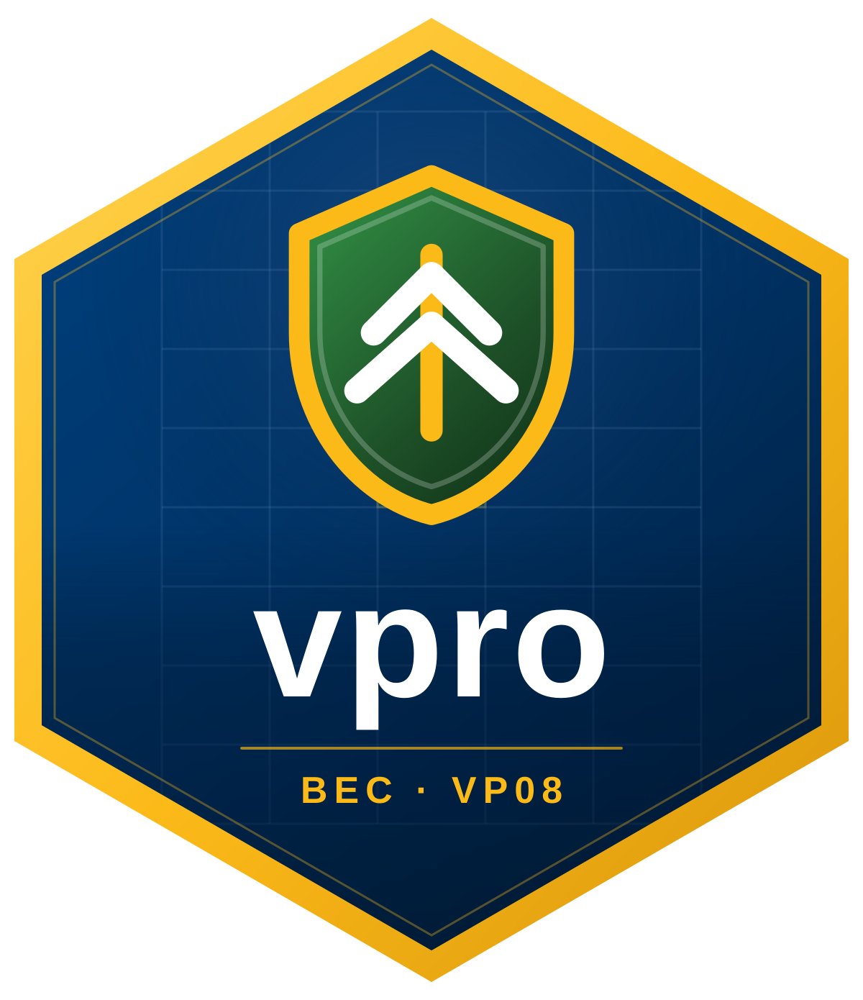

# VPro 2.0 (`Boostao/vpro`) 

Unified cross-platform **Biogeoclimatic Ecosystem Classification (BEC)** plot, classification, 3D geospatial, diagnostic synthesis, Cloud `BECMaster` stewardship, and scientific R analytics ecosystem for the **B.C. Ministry of Forests, Research Branch — BEC Program** (*VENUS — Vegetation and Environment NexUS — Professional*).

- **Official Download & Documentation Portal:** <https://boostao.github.io/vpro/>
- **Headless R Companion SDK (`pkgdown`) Reference:** <https://boostao.github.io/vpro/r/>
- **Source Repository:** <https://github.com/Boostao/vpro>

---

## Two Synchronized Tracks, One Canonical `VP08` Data Contract

`Boostao/vpro` pairs a zero-Access-runtime native desktop workstation with a programmatic R analytics & stewardship SDK over a shared **7-database SQLite (`VP08`, `WAL` mode) + `config.yml` + PostgreSQL/PostGIS `BECMaster`** contract:

1. **VPro 2.0 Desktop Workstation ([`app/`](./app/))** — Built with **Go `1.27+`**, **Wails v3**, **Svelte 5**, **MapLibre GL JS v6 + WebGPU + offline `PMTiles`**, **CGO SQLite (`WAL`)**, **`pgx/v5`**, and vendored **`libmdb` (`mdbtools` 1.0.1)** across Windows (`x64`/`arm64`), macOS Universal (`VPro.app`), and Linux (`x64`/`arm64`). Delivers paper-faithful FS882, Two-Page, and FS1333 (SIVI) editors (with inline CHARS shrub-layer toggle), Universal Datasheet Grid, Dual-Pane `SU`/`Hierarchy` Tree Explorer, 3-Way Project Merge, streaming `545 MB` (`71,567`-plot) `BECMaster` `.accdb` import, reactive BEC Diagnostics, R Sidecar (`climr -> aSMR`, `vegclust`, Quarto), Cloud `BECMaster` sync, 100% offline `F1` `LMH25 (2023)` contextual help, and complete interchange (`VENUS 5.0`, **TurboVeg 3 31-table SQLite & `Plot_package` XML**, OGC `GeoPackage`, R `.rds`, Long/Wide CSV, KML, Label PDF).
2. **Headless `vpro` R Companion SDK ([`r/`](./r/), `R >= 4.4.0`)** — Pure programmatic R package (**zero Shiny/widget dependencies**) providing concurrent read-only SQLite WAL access alongside an open Desktop session, 2026 `BCPlantTaxonomy v19` (`16,728` taxa) & `BECdb v13` (`8,900` site series) harmonization, `vegan`/`vegclust`/`indicspecies`/`labdsv` community matrices & noise clustering, `sf` GeoPackage workflows, `bcgov/climr` normals & Ministry `CMD -> aSMR` dual edatopic grids, BEC differential fidelity (`d`, `dd`, `cd`, `c`, `ic`), guarded `BEGIN IMMEDIATE` candidate `*_SU` write-back, PostgreSQL `BECMaster` staging/3-way-merge/snapshots, and reproducible BC Gov Quarto ecosystem guides.

---

## Quickstart

### 1. Install VPro 2.0 Desktop (`app/`)

Download the latest self-contained Windows (`.exe` NSIS installer), macOS Universal (`.dmg`), or Linux (`.AppImage` / `.deb` / `.tar.gz`) release with SHA-256 verification from **<https://boostao.github.io/vpro/>**.

### 2. Install the Headless `vpro` R Companion SDK (`r/`)

Install directly from the `r/` subdirectory of `Boostao/vpro`:

```r
# Recommended (pak)
pak::pak("Boostao/vpro/r")

# Or via remotes
remotes::install_github("Boostao/vpro", subdir = "r")
```

Connect concurrently (read-only WAL) to your local VPro 2.0 workspace:

```r
library(vpro)

# Resolves identical cross-OS workspace paths to VPro Desktop (app/)
vpro_data_dir()
vpro_config_dir()
vpro_list_projects()

# Open bundled Sample project (or use vpro_connect() on a workspace .db)
ctx <- vpro_sample()
env <- vpro_env(ctx)
mat <- vpro_matrix(ctx, transform = "hellinger")
diag <- vpro_diagnostics(ctx)
```

---

## Monorepo Architecture

| Path | Role & Key Contents |
|---|---|
| **[`app/`](./app/)** | **VPro 2.0 Desktop Workstation** (`github.com/boostao/vpro/app`): Thin Wails host (`12` domain services), 4-layer acyclic `app/internal/*` Go DAG, embedded 2026 standards (`app/resources/`), and Svelte 5 + MapLibre v6/WebGPU frontend (`app/frontend/`). Guide: [`app/AGENTS.md`](./app/AGENTS.md). |
| **[`r/`](./r/)** | **Headless `vpro` R Companion SDK** (`R >= 4.4.0`): `25` `r/R/*.R` modules, `testthat` suite, `5` vignettes, BC Gov Quarto templates (`r/inst/quarto/`), and `pkgdown` reference (<https://boostao.github.io/vpro/r/>). Guide: [`r/AGENTS.md`](./r/AGENTS.md). |
| **[`okf/`](./okf/00_index.md)** | **Operational Knowledge Framework**: Past/Present/Future forensics, [`VP08` Data Dictionary](./okf/02_present_state/data_dictionary.md), [9 Empirical Access/BEC Oracles](./okf/02_present_state/oracles/), and [Deep Engineering Playbooks](./okf/05_engineering_and_agents/). |
| **[`docs-src/`](./docs-src/)** | Single-source JSON field dictionary (`LMH25 2023`), user guides, 4 spotlight tours, keyboard shortcuts, and 9-clause `BECWeb` Data Use Agreement compiled into `app/resources/help_bundle.json`. |
| **[`site/`](./site/)** | BC Government Design System (`BC Sans`, `#003366` BC Navy, `#FCBA19` Gold) zero-API-call static-manifest release & documentation portal (<https://boostao.github.io/vpro/>). |
| **[`scripts/`](./scripts/)** | Help bundle compiler (`build-docs-src.mjs`), cross-platform release orchestrator & Windows PE DLL validator (`release.py`, `release-windows.ps1`), and portal/packaging tests (`scripts/tests/`). |
| **[`.github/`](./.github/)** | Unified CI/CD (`ci.yml`, `pages.yml`, `release.yml`), [Copilot instructions](./.github/copilot-instructions.md), and domain agents (`vba-analyzer`, `vproguy`). |
| **[`archive/`](./archive/oct2026-parity-ledgers/)** | Historical October 2026 parity ledgers preserved strictly for provenance reference. |

---

## Authoritative Documentation (`okf/`)

- **Master Manifest & BEC Domain Taxonomy:** [`okf/00_index.md`](./okf/00_index.md)
- **System Architecture (`app/` 4-Layer Go DAG + `r/` R SDK):** [`okf/02_present_state/system_architecture.md`](./okf/02_present_state/system_architecture.md)
- **Capability & Client Triage Matrix:** [`okf/02_present_state/capability_matrix.md`](./okf/02_present_state/capability_matrix.md)
- **Canonical `VP08` Data Dictionary & 2026 Standards:** [`okf/02_present_state/data_dictionary.md`](./okf/02_present_state/data_dictionary.md)
- **Empirical Access & BEC Oracles (`9` Specs):** [`okf/02_present_state/oracles/`](./okf/02_present_state/oracles/)
- **Governance, GIS, Interchange & Automations (`Auto-1`..`Auto-7`):** [`okf/03_future_architecture/analytics_and_governance.md`](./okf/03_future_architecture/analytics_and_governance.md) · [`intelligent_automation_and_abstractions.md`](./okf/03_future_architecture/intelligent_automation_and_abstractions.md) · [`documentation_help_and_release_portal.md`](./okf/03_future_architecture/documentation_help_and_release_portal.md)
- **Deep Engineering Playbooks:** [`desktop_app_engineering.md`](./okf/05_engineering_and_agents/desktop_app_engineering.md) · [`r_sdk_engineering.md`](./okf/05_engineering_and_agents/r_sdk_engineering.md)

---

## Developer Build & Validation Quickstart

### Prerequisites
- **Desktop (`app/`):** Go `1.27+` (`CGO_ENABLED=1`), Node `24+`, `wails3` (`v3.1.0`), plus GTK4/WebKitGTK 6.0 dev packages on Linux or MinGW/LLVM-MinGW + `makensis` on Windows.
- **R Companion SDK (`r/`):** R `>= 4.4.0` (`Rscript`), `quarto` CLI (optional), and `air` formatter (optional).

```bash
# --- Desktop Workstation (app/) ---
(cd app && wails3 dev)                                         # Live native dev window
(cd app && wails3 generate bindings -ts -i)                    # Regenerate TS interface bindings (-i required)
(cd app/frontend && npm test && npm run check && npm run build)
(cd app && go test ./...)
(cd app && wails3 task linux:build)
(cd app && wails3 task windows:build)

# --- Headless R Companion SDK (r/) ---
(cd r && Rscript -e "roxygen2::roxygenise()")
(cd r && Rscript -e "testthat::test_local(stop_on_failure = TRUE)")
(cd r && R CMD build . && R CMD check --no-manual vpro_*.tar.gz && rm -rf vpro_*.tar.gz vpro.Rcheck)

# --- Dependency Lockstep, Offline Help Bundle, Release Portal & Packaging Checks ---
python3 scripts/check-dep-lockstep.py
python3 -m unittest discover -s scripts/tests -p 'test_*.py'
node scripts/build-docs-src.mjs && node site/build.mjs && node --test scripts/tests/downloadPortal.test.cjs
```

## Governance, Roadmap & Security

- **[Product Roadmap](./ROADMAP.md)** — Multi-horizon trajectory (`v2.0` hardening $\rightarrow$ Provincial Cloud `BECMaster` / `BECWeb 2.0` $\rightarrow$ Field Tablet PWA, Card OCR & `VTrees`/CWD/WHA).
- **[Contributing & Release Runbook](./CONTRIBUTING.md)** — 4-tier dependency update policy, annual `BECdb`/`BCPlantTaxonomy` standards ingestion, 5-tier testing pyramid, and BC field-season release cadence.
- **[Security & Ecological Data Custody](./SECURITY.md)** — Vulnerability reporting, PostgreSQL TLS/RBAC guarantees, and local-first `VP08` data protection.

## License

Licensed under the [Apache License, Version 2.0](./LICENSE).

