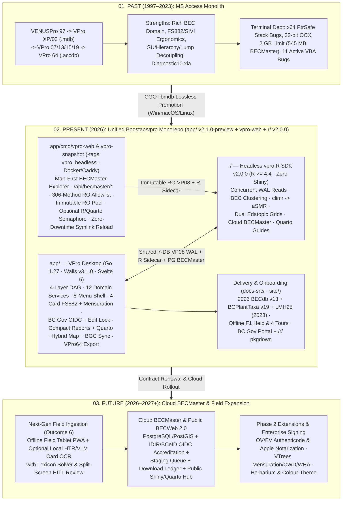

# VPRO Operational Knowledge Framework (`okf`) — Master Manifest & Executive Summary

**System:** VPRO — Biogeoclimatic Ecosystem Classification (BEC) Plot & Classification Management Ecosystem  
**Custodian / Domain Authority:** Province of British Columbia, Ministry of Forests (Will H. MacKenzie, Provincial BEC Research Ecologist)  
**Legacy Architect (`1997–2023`):** Russell Klassen (`VENUSPro 97` $\rightarrow$ `VPro 64`, `vuser.ca`)  
**Modernization Engineering (`2026`):** BooSTAO IT Consultancy Ltd. (`Boostao/vpro` unified monorepo — `app/` Desktop Workstation, `vpro-web` Read-Only Web Server & `r/` Headless R Companion SDK, Contract `RE26OCF433`)  
**Canonical Repository Path:** `okf/` (in-tree at root of `Boostao/vpro`)  
**Audit Baseline Date:** `2026-11-26` (`Boostao/vpro` `main` · Desktop `app/` `v2.1.0-preview` · Read-Only `vpro-web` / `vpro-snapshot` · R SDK `r/` `v2.0.0`, `89` exports)

---

## 1. Executive Summary

**VPro** (*VENUS — Vegetation and Environment NexUS — Professional*) is British Columbia's foundational ecological informatics platform—analogous to **TurboVeg + JUICE** in European phytosociology—supporting the **Biogeoclimatic Ecosystem Classification (BEC)** program, Terrestrial Ecosystem Mapping (**TEM**), Site Index–BEC (**SIBEC**), Canadian High Arctic Research Station (**CHARS**) surveys, and climate-resilient forestry tools such as **CCISS** (`VProXP_Userguide.pdf` PDF pp. 13–21; `LMH25_2023_web.pdf` PDF pp. 4, 270–272; `RE26OCF433` Schedule A).

Synthesizing forensic evidence across **200 remote distributions on `http://vuser.ca/` (`~1.14 GB`)**, **22 Microsoft Access `.accdb`/`.mdb`/`.accda` binaries** (including the **545 MB `BECMaster_fixing.accdb`** holding **71,567 plots** and **1,651,842 vegetation records**), **127 VBA modules & 108 Access forms**, **106 client emails**, **3 sequential versions of Contract `RE26OCF433` Schedule A**, Will MacKenzie's **20-page ink-coded `VPro2.0_Functions` triage**, **795 pages of `LMH25` & `VProXP` manuals**, **2026 `BECWeb` standards (`BECdb v13` & `BCPlantTaxonomy v19`)**, and the unified **`Boostao/vpro` monorepo (`app/` Desktop Workstation & `r/` Headless R Companion SDK)**, this in-tree knowledge framework establishes the definitive Past, Present, and Future technical record of VPro:

1. **The Past (`1997–2023`):** Originating as **`VENUSPro 97`** on Access 97 (`OldVPro.docx`), VPro evolved through eight table-schema revisions (`VP01`–`VP08`) culminating in **VPro 64** (`2023-02-23`, `VPro64-23Feb2023.zip`). While its ecological domain model is battle-tested, the Access architecture reached terminal technical debt: 64-bit `Declare PtrSafe` stack/pointer truncation crashes (`V7mdlRibbonPictureBAS.txt:79`), dead 32-bit ActiveX controls (`comctl32.ocx`), non-transactional `DELETE *` SQL, live Excel session hijacking (`<= 250`-column cap), single-user `QueryDef` mutation, 11 confirmed VBA/schema bugs, and Access's hard 2.0 GB file ceiling ([Legacy Architecture](./01_history_and_evolution/legacy_architecture.md)).
2. **The Present (`2026` — Unified `Boostao/vpro` Monorepo: `app/` Desktop `v2.1.0-preview`, Read-Only `vpro-web` & `r/` R SDK `v2.0.0`):** Under Contract `RE26OCF433`, VPro operates inside the unified **`Boostao/vpro`** repository over a **canonical 7-database SQLite (`VP08`, `WAL` mode) + `config.yml` + PostgreSQL `BECMaster` contract** served by three synchronized, production-qualified delivery surfaces ([System Architecture](./02_present_state/system_architecture.md)):
   * **VPro Desktop Workstation — `app/` (`github.com/boostao/vpro/app`, `v2.1.0-preview`):** Cross-platform desktop workstation (**Go `1.27+` + Wails `v3.1.0` + Node `24+` + Svelte `5.57+` + CGO SQLite `WAL` + vendored C `libmdb` on Windows/macOS/Linux**) organized into a **4-layer acyclic `app/internal/*` DAG (`12` registered Wails domain services, `285` `.svelte` components, streamlined 8-menu shell: `Work Space`, `Forms`, `Reports`, `Analysis`, `Project Management`, `Map`, `Interchange`, `Help`, default-ON `stable` release channel)**. Ships bundled **2026 `BECdb v13` (`8,900` site series), `BCPlantTaxonomy v19` (`16,728` taxa), and `LMH25 (2023)`** catalogues (with `<dataDir>/readmodels/vlists-lookup.db` read-model isolation); **Editable 4-Card Classic FS882** (Site, Soil, Veg, and **Mensuration Card 4** backed by optional `<Project>_TreePlot` [26 cols] & `<Project>_Trees` [43 cols]), **4 card layout modes** (`Single`, `Side-by-Side`, `Top-Down`, `Grid`), sticky **Access Record Selector** (`|< < [N] of M > >|` + PlotNumber search), Two-Page/SIVI editors (with inline CHARS shrub-layer toggle and Red over-builds pruned); **BC Gov OIDC PKCE one-time machine sign-in (`app/internal/auth/`) + central default edit lock (`vprocore/edit_lock.go`)** with role-tiered working-project unlock, `BECMaster` Custodian gate, offline session caching, and dev-only evaluation fallback; **Universal Datasheet Grid** (including `_TreePlot`/`_Trees`); virtualized **Dual-Pane `SU/Hierarchy` Explorer**; unified **Work Space** sidebar (`Attach`/`Remove`/`New`, unified `.accdb`/`.mdb` attach-convert, `Export to VPro64`); full **Project Lifecycle & 3-Way Merge** (`New`, `SaveAs`, `Splinter`, `Compare`, `Merge`, `OptimizeVeg`, batch `USysTableOfLists` compliance gate, and streaming `545 MB` `BECMaster` import with orphan-row quarantine); **`Combine Species`** (`*_Lump` CRUD + declarative `LumpSpec`); **compact VPro64-style Reports** (6 Veg/Env reports with auto-defaults, `Export to Spreadsheet` + sandboxed HTML `Display Report` preview, plus elevated `Reports -> Quarto Unit Report` with instant HTML fallback); dedicated **`Analysis`** menu (reactive BEC Diagnostic & Pairwise Synthesis `Auto-3` + out-of-process R Sidecar `Auto-7`: `climr -> aSMR`, `vegclust`, Quarto HTML/PDF guides); in-app **3D MapLibre GL JS v6 + WebGPU + offline `PMTiles`** geospatial workbench (`Auto-1`) with hybrid basemaps (`Esri World Imagery Hybrid`, `Google Hybrid`, `OpenStreetMap`, `BC Gov Topo`), BC Forest Regions overlay, and atomic **BGC Map Sync**; live **`LMH25` pedon/`rSMR`/`rSNR` rules (`Auto-2`)** & auto-derived `ProjectMetadata` (`Auto-6`); PostgreSQL **`BECMaster` Cloud Sync (`app/internal/cloudsync`, `31` tables across `becmaster`/`staging`/`standards`)**; complete **Interchange Hub** (**VPro64 SQLite-for-ODBC export** paired with `scripts/vpro64/V7mdlImportSQLite.bas` replacing user-facing VENUS 5, official **`TurboVeg 3` 31-table SQLite & `Plot_package` XML**, OGC `GeoPackage`, R `.rds`, Long/Wide CSV, `User Species`, KML, Label PDF); **100% offline `F1` `LMH25` help (`app/resources/help_bundle.json`) + 4 spotlight tours** authored in plain CBC-level language (`docs-src/`); and the **BC Gov Design System static-manifest release portal** (`site/`) ([Capability Matrix](./02_present_state/capability_matrix.md), [Desktop Engineering Playbook](./05_engineering_and_agents/desktop_app_engineering.md)).
   * **Headless R Companion SDK — `r/` (`vpro` `v2.0.0`):** Clean-slate **headless R companion SDK (`43` `r/R/*.R` files, `89` exports, `R >= 4.4.0`, zero Shiny/widgets, zero-note `R CMD check`, qualified against 71,567-plot `BECMaster`)** providing concurrent SQLite WAL read access alongside `app/`, `BCPlantTaxonomy v19` & `BECdb v13` harmonization, community matrices, multivariate BEC clustering, `sf` GeoPackage export, `LMH25 (2023)` pedological validation, `climr` normals & Ministry `CMD -> aSMR` modelling, dual edatopic grids, BEC diagnostic synthesis, guarded candidate `*_SU` write-back, Wave 6 PostgreSQL **`BECMaster` cloud sync/staging/snapshots** (`r/R/cloud_*.R`), 6 scientist vignettes, and BC Gov Quarto BEC guides ([R SDK Engineering Playbook](./05_engineering_and_agents/r_sdk_engineering.md)).
   * **Pure-HTTP Read-Only Web Server — `app/cmd/vpro-web` & `app/cmd/vpro-snapshot` (`deploy/vpro-web/`):** Headless Go server compiled with `-tags vpro_headless` (zero Wails/GTK/WebKit/`accessreader` deps), serving a **Map-First `BEC_plots_Shiny`-aligned Web BECMaster Explorer** (`WebBECMasterExplorer.svelte`, `/api/becmaster/{filter-options,filter,download}`, `VPRO_WEB_EXTERNAL_LINKS_JSON`, OGL-BC licence & citation, Classic FS882 Read-Only Card Drawer, and 6 subset download formats) over a strict **306-method read-only RPC allowlist** (`12` services: `229` `rpc`, `50` `prefs`, `27` `download`), concurrent **`ReadOnlyContextPool`** (`mode=ro&immutable=1`), fail-closed `RedBlueList`-redacted & zero-audit immutable `BECMaster` snapshots (`vpro-snapshot build` / `verify`), optional semaphore-bounded read-only R/Quarto sidecar (`INCLUDE_R=true` vs. ~55 MB Go-only image), and Caddy + Docker Compose + GitHub Actions `dev`/`prod` deployment on DigitalOcean ([Web Read-Only Deployment Runbook](./05_engineering_and_agents/web_readonly_deployment.md)).
3. **The Future (`2026–2027` Phase 2 Cloud & Field Roadmap):** Extend the completed local workstation and R SDK into the multi-user **Cloud `BECMaster` PostgreSQL/PostGIS** stewardship tier (IDIR/BCeID OIDC accreditation, staging submission queue, tamper-evident audit ledger, download logging, and public Shiny/Quarto **`BECWeb 2.0`** map & guide portal per `Schedule A 1–2, 6`), add optional enterprise OV/EV Authenticode & Apple Developer ID code signing, deliver offline **Field Tablet PWA + confidence-scored HITL Field Card HTR/OCR** (`Outcome 6`), and evaluate Phase 2 companion modules (`VTrees` Mensuration/Kozak taper, CWD, WHA, Herbarium, Colour-Theme, Hierarchy Diagram) ([Target Stack Recommendation](./03_future_architecture/target_stack_recommendation.md)).

---

## 2. Past $\rightarrow$ Present $\rightarrow$ Future Architectural Trajectory



---

## 3. Repository Directory Structure & Complete Document Manifest

```text
okf/
├── AGENTS.md                           # Self-curating okf/ memory & synchronization protocol
├── 00_index.md                         # Master manifest, domain taxonomy, and executive summary (this file)
├── 01_history_and_evolution/
│   ├── version_matrix.md               # 1997–2026 release lineage (VENUSPro 97 -> VPro 64 -> Boostao/vpro)
│   ├── legacy_architecture.md          # Access/DAO/VBA/COM architecture, 22 DBs, x64 bugs & 11 confirmed defects
│   └── site_archive_manifest.md        # Cryptographic inventory of vuser.ca (35 URLs, 200 files) & local matches
├── 02_present_state/
│   ├── domain_model.md                 # BEC domain invariants, LMH25 (2015 vs 2023) cards & 3 core personas
│   ├── core_workflows.md               # Session context, Access import, entry, QA, profiling & reporting flows
│   ├── system_architecture.md          # Unified Boostao/vpro: app/ (Go/Wails/Svelte 5) & r/ (headless vpro SDK)
│   ├── capability_matrix.md            # 4-way parity audit: VPro64 vs Client Triage/RE26OCF433 vs r/ vs app/
│   ├── data_dictionary.md              # VP08 8-table schema, SU/Hierarchy/Lump, VLists, views & __VPRO_* tables
│   └── oracles/                        # 9 empirical Access DAO & BEC math/validation oracle specifications
│       ├── COORDINATE_CONVERSIONS.md
│       ├── DIAGNOSTIC_CLASSIFICATION.md
│       ├── ENVIRONMENT_CODE_VALIDATION.md
│       ├── REPORT_QUALITY_FILTER.md
│       ├── SHORT_VEG_LAYER_MAPPING_DESIGN.md
│       ├── SHORT_VEG_LAYER_STRATA_ORACLE.md
│       ├── VALUE_CONVERSIONS.md
│       ├── VEGETATION_CODE_VALIDATION.md
│       └── VEGETATION_OPTIMIZATION_POLICY.md
├── 03_future_architecture/
│   ├── transition_and_adoption.md                  # Zero-friction UX continuity, datasheet grid, tree explorer & rollout plan
│   ├── next_gen_entry_ocr.md                       # Offline PWA + FS882/FS1333 HTR/OCR lexicon solver & HITL review pipeline
│   ├── analytics_and_governance.md                 # In-app MapLibre v6 + WebGPU GIS, BECMaster Postgres, GeoPackage, TurboVeg3, BEC_R
│   ├── target_stack_recommendation.md              # Stack trade-offs, federated Wails + R/Cloud rationale & service consolidation
│   ├── intelligent_automation_and_abstractions.md  # 7 implementation-ready domain automations (LMH25 keys, live Diagnostics, 3-way merge)
│   └── documentation_help_and_release_portal.md    # Offline F1 LMH25 help, guided tours & BC Gov Design System release portal
├── 04_evidence_and_sources/
│   ├── citations_index.md              # Direct mapping to contracts, 106 emails, manuals, vuser.ca & code lines
│   └── decisions_and_gaps.md           # Domain/contract/technical decision register (D-01–D-15)
└── 05_engineering_and_agents/
    ├── desktop_app_engineering.md      # Deep Go/Wails v3/Svelte 5/CGO/COM/SQLite WAL/cloudsync engineering playbook (app/)
    ├── r_sdk_engineering.md            # Deep headless R SDK/SQLite WAL/Access calibration/BECMaster cloud playbook (r/)
    ├── web_readonly_deployment.md      # Read-only vpro-web & vpro-snapshot DigitalOcean, Caddy & GitHub Actions runbook
    └── vpro64_sqlite_import.md         # VPro64 VBA SQLite3 ODBC importer (scripts/vpro64/V7mdlImportSQLite.bas) setup & guide
```

| Module | Document Link | Core Contents & Key Takeaways |
|---|---|---|
| **`00`** | **[Master Index](./00_index.md)** · **[`okf/AGENTS.md`](./AGENTS.md)** | Executive synthesis, BEC domain glossary/taxonomy, cross-monorepo navigation, and the self-curating `okf/` memory protocol. |
| **`01.1`** | **[Version Matrix](./01_history_and_evolution/version_matrix.md)** | `VENUSPro 97` discovery, single `2009-06-22` `.accdb` lineage, all 37 `vuser.ca` VPro builds, deprecated vs. persistent features. |
| **`01.2`** | **[Legacy Architecture](./01_history_and_evolution/legacy_architecture.md)** | Hub-and-spoke `acLink` + rewritten `QueryDefs`, BEC diagnostic math, `VTrees` Kozak taper, x64 `PtrSafe` stack corruption, 11 active bugs. |
| **`01.3`** | **[Site Archive Manifest](./01_history_and_evolution/site_archive_manifest.md)** | Complete crawl of `http://vuser.ca/` (`120` `/vpro*` + `80` companion files = `200` files, hidden `/vpro/` archive) & SHA-256 local matches. |
| **`02.1`** | **[Domain Model](./02_present_state/domain_model.md)** | Field Crew, BEC Ecologist/Custodian, and Climate Scientist personas; `LMH25` `2015` vs. `2023` edition diff; 7 domain invariants. |
| **`02.2`** | **[Core Workflows](./02_present_state/core_workflows.md)** | Mermaid sequence/flow diagrams for Access import, `Enter`-key/datasheet entry, 3-way merge, reactive Diagnostics, 3D GIS, and interchange. |
| **`02.3`** | **[System Architecture](./02_present_state/system_architecture.md)** | Deep dive into `Boostao/vpro`: `app/` (`4`-layer DAG, `12` Wails services, `SQLiteContext` WAL, `libmdb` CGO, Svelte 5, R sidecar), `r/` `vpro` SDK, and pure-HTTP read-only `vpro-web` / `vpro-snapshot`. |
| **`02.4`** | **[Capability Matrix](./02_present_state/capability_matrix.md)** | Exhaustive parity table auditing every VPro 64 ribbon/dialog control against `VPro2.0_Functions` ink marks, `RE26OCF433`, `r/` `v2.0.0`, and `app/` `v2.0.0`. |
| **`02.5`** | **[Data Dictionary](./02_present_state/data_dictionary.md)** | Complete ER diagram and column-level specification for all 8 `VP08` project tables, 2026 `BECdb v13` / `BCPlantTaxonomy v19` catalogues & `__VPRO_*`. |
| **`02.6`** | **Empirical Access & BEC Oracles (`02_present_state/oracles/`)** | 9 disposable-VM DAO & domain calibration specs: [Coordinate Conversions](./02_present_state/oracles/COORDINATE_CONVERSIONS.md) · [Diagnostic Classification](./02_present_state/oracles/DIAGNOSTIC_CLASSIFICATION.md) · [Env Code Validation](./02_present_state/oracles/ENVIRONMENT_CODE_VALIDATION.md) · [Report Quality Filter](./02_present_state/oracles/REPORT_QUALITY_FILTER.md) · [Short-Veg Layer Mapping](./02_present_state/oracles/SHORT_VEG_LAYER_MAPPING_DESIGN.md) · [Short-Veg Strata Oracle](./02_present_state/oracles/SHORT_VEG_LAYER_STRATA_ORACLE.md) · [Value Conversions](./02_present_state/oracles/VALUE_CONVERSIONS.md) · [Veg Code Validation](./02_present_state/oracles/VEGETATION_CODE_VALIDATION.md) · [Veg Optimization Policy](./02_present_state/oracles/VEGETATION_OPTIMIZATION_POLICY.md). |
| **`03.1`** | **[Transition & Adoption](./03_future_architecture/transition_and_adoption.md)** | UX continuity rules (datasheet grid, dual-pane tree, inline CHARS), 545 MB `BECMaster` qualification, and desktop-to-cloud rollout roadmap. |
| **`03.2`** | **[Next-Gen Entry & OCR](./03_future_architecture/next_gen_entry_ocr.md)** | Forensic clarification of Outcome 6, Rite-in-the-Rain HTR/VLM feasibility, `USysAllSpecs` lexicon solver, horizon/substrate constraints & HITL UI. |
| **`03.3`** | **[Analytics & Governance](./03_future_architecture/analytics_and_governance.md)** | In-app MapLibre v6 + WebGPU + `PMTiles` GIS, Cloud `BECMaster` Postgres + OIDC RBAC, `GeoPackage`, official `TurboVeg 3` SQLite + XML, `.rds`, and `climr`. |
| **`03.4`** | **[Target Stack Recommendation](./03_future_architecture/target_stack_recommendation.md)** | Federated Go/Wails/Svelte 5 desktop (`app/`) + headless `vpro` R SDK (`r/`) + Cloud Postgres/Shiny/Quarto rationale & `86 -> 12` service consolidation. |
| **`03.5`** | **[Automations & Abstractions](./03_future_architecture/intelligent_automation_and_abstractions.md)** | Architecture & implementation record for `Auto-1`..`Auto-7` (`.pmtiles` auto-stamp, `LMH25` rules, live Diagnostics, 3-way merge, `LumpSpec`, metadata, R sidecar). |
| **`03.6`** | **[Docs, Help & Release Portal](./03_future_architecture/documentation_help_and_release_portal.md)** | Single-source `docs-src/` offline `F1` `LMH25` help, 4 spotlight tours, static `release-manifest.json` BC Gov Design System portal (`site/`) & signing roadmap. |
| **`04.1`** | **[Citations Index](./04_evidence_and_sources/citations_index.md)** | Master lookup mapping claims to exact contracts, emails, PDF pages, Access modules/lines, `vuser.ca` SHA-256s, and `app/` / `r/` files. |
| **`04.2`** | **[Decisions & Gaps](./04_evidence_and_sources/decisions_and_gaps.md)** | Updated decision & resolution register (`D-01`–`D-15`) tracking resolved desktop/R/read-only web/client-feedback architecture & sign-offs and remaining client/cloud governance items. |
| **`05.1`** | **[Desktop App Engineering Playbook](./05_engineering_and_agents/desktop_app_engineering.md)** | Complete Go `github.com/boostao/vpro/app` 4-layer DAG, 12 Wails services, CGO/GTK/COM/chunked IPC/Excelize/Svelte 5 `$state.snapshot` & `cloudsync` invariants. |
| **`05.2`** | **[Headless R SDK Engineering Playbook](./05_engineering_and_agents/r_sdk_engineering.md)** | Complete `r/` zero-Shiny boundary, SQLite WAL RO/write-back guards, Access/BEC oracle calibration, Wave 6 Cloud `BECMaster`, `air`, and tarball `R CMD check` gates. |
| **`05.3`** | **[Web Read-Only Deployment Runbook](./05_engineering_and_agents/web_readonly_deployment.md)** | Operator runbook for `vpro-web` + `vpro-snapshot` (`-tags vpro_headless`, Caddy + Docker Compose, DigitalOcean provisioning, GitHub Environments/Secrets, zero-downtime symlink reload, and `RedBlueList` redaction sign-off gate). |
| **`05.4`** | **[VPro64 VBA SQLite Importer Guide](./05_engineering_and_agents/vpro64_sqlite_import.md)** | One-time 64-bit SQLite3 ODBC Driver setup and operator guide for `scripts/vpro64/V7mdlImportSQLite.bas` (lossless VPro 2.0 `.db` $\rightarrow$ VPro64 `.accdb` import). |

---

## 4. Canonical BEC & VPRO Domain Taxonomy

| Term / Acronym | Canonical Definition |
|---|---|
| **BEC / BGC** | **Biogeoclimatic Ecosystem Classification / Biogeoclimatic Unit:** BC's hierarchical climate-and-site ecosystem framework (`Zone -> Subzone -> Variant -> Phase / Site Series`, fixed-width mask `ZZZZsssvp/##`, e.g., `SBS dk 1 /01`). |
| **`BECMaster` & `BECdb`** | Provincial master plot repository (`71,567+` plots in `BECMaster_fixing.accdb` $\rightarrow$ target PostgreSQL) and official correlated classification unit names database (`BECdb v13`, `2026-05-28`, `8,900` rows in `USysSiteSeriesNames` & `6,067` in `MasterSiteUnitList`). |
| **rSMR / aSMR & rSNR** | **Relative / Actual Soil Moisture Regime** (`0` Very Xeric to `8` Hydric; `aSMR` derived from `climr` Climatic Moisture Deficit `CMD` + site edaphics) and **Relative Soil Nutrient Regime** (`A` Very Poor to `F` Saline), forming the two axes of the **Edatopic Grid**. |
| **`FS882` & `FS1333 (SIVI)`** | Standard BC terrestrial ecosystem field cards (`LMH25` 2nd Ed., `2015` & `2023`): `FS882(1–7)` (`400 m²` full plot: Site, Soil/Humus, Veg, Mensuration, WHA, TAW, CWD) and `FS1333` (**Site Visit** form for TEM/SIBEC Ground Inspections `G`, Visual Calls `V`, and Site Notes `N`). |
| **`CHARS`** | **Canadian High Arctic Research Station:** Polar/subarctic survey extension adding shrub height sub-layers (`Cover5a..5c`, `Height5a..5c`), `SnowCoverregime` (`SCR`), and permafrost `ActiveLayerDepth` (`<Project>_Env`, `<Project>_Veg`). |
| **`VP08`** | Table Version 8.0 (`2019–2026` canonical project schema): 8 relational tables per project (`_Env`, `_Admin`, `_Veg`, `_Humus`, `_Mineral`, `_Other`, `_Audit`, `_Metadata`) joined on `PlotNumber` (`Text 7`). |
| **Site Unit (`*_SU`)** | Two-column (`PlotNumber, SiteUnit`) table serving simultaneously as VPRO's **active session plot filter** (`Filtered_Env`) and **mutable working classification hypothesis** (`UserSiteUnit` vs. custodian-locked `BECSiteUnit`). |
| **Breakpoint (`~`)** | Prefix marker (`~NodeName`) placed on `<Name>_Hierarchy` nodes to aggregate descendant site units dynamically during reporting or analysis. |
| **Lumping (`*_Lump`)** | Non-destructive query/report-time taxonomic mapping (`SppCode -> LumpCode`, `Use = True`) combining subspecies, varieties, or cryptic species complexes (summed cover capped at `99%`) without altering raw `<Project>_Veg` codes. |
| **Plot Profiling (`*_Profile`)** | Ordered set-algebra query engine (`Add plots` $\cup$, `Common plots` $\cap$, `Subtract plots` $\setminus$) filtering plots across `Env`, `Veg` layers, species absence (`IS NULL`), and `Lump` criteria. |
| **Diagnostic / Differential Taxa** | Phytosociological species fidelity classes (`d` Differential, `dd` Dominant Differential, `cd` Constant Dominant, `c` Constant, `ic` Important Companion) computed across BEC units via Presence (`I–V`) and Domin-Krajina Significance (`+`, `1–9`). |
