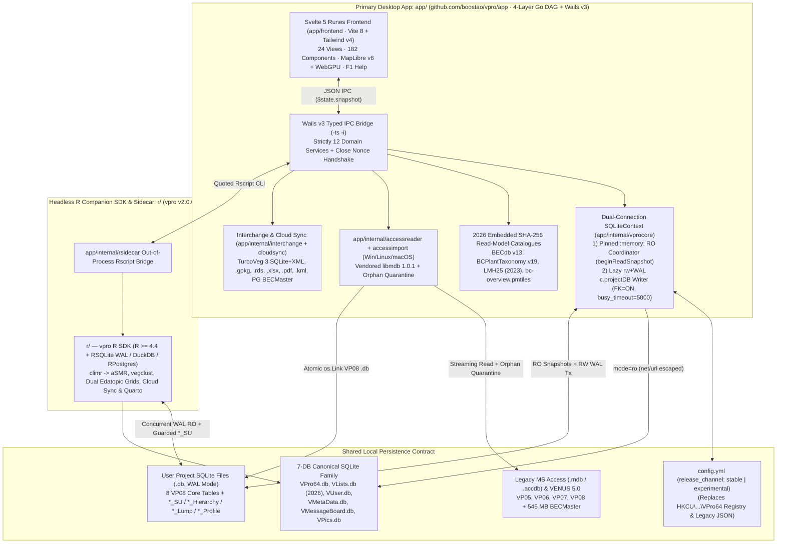
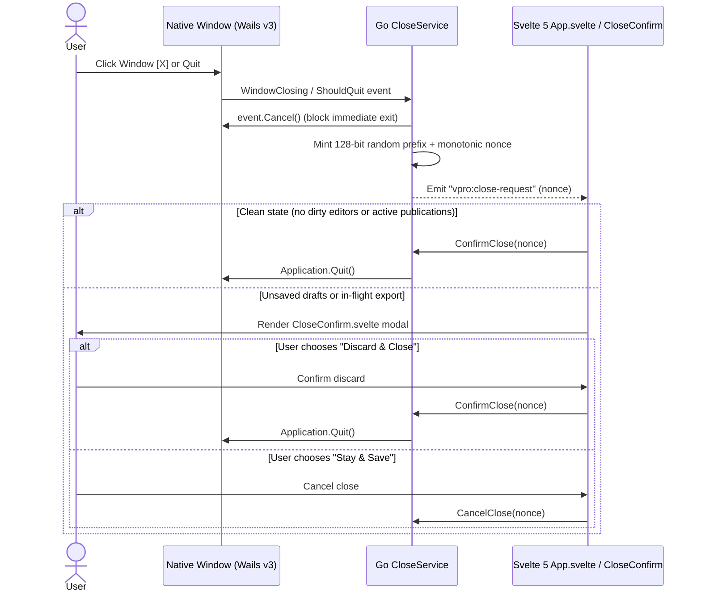
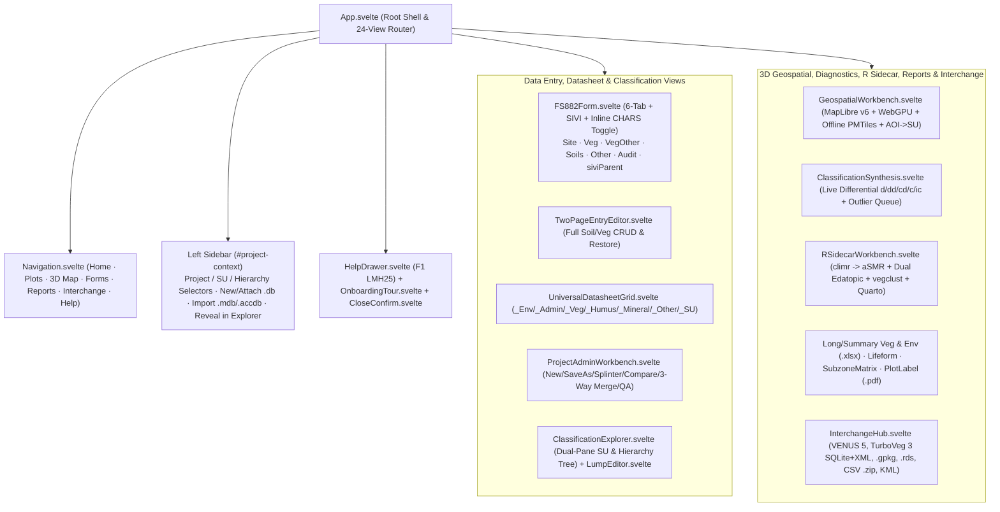

# Present State System Architecture (`Boostao/vpro`: `app/` & `r/`)

> **Navigation:** [Master Index](../00_index.md) | **Present State:** [Domain Model](./domain_model.md) · [Core Workflows](./core_workflows.md) · `System Architecture` · [Capability Matrix](./capability_matrix.md) · [Data Dictionary](./data_dictionary.md) · [Oracles](./oracles/DIAGNOSTIC_CLASSIFICATION.md) | **Playbooks:** [Desktop Engineering](../05_engineering_and_agents/desktop_app_engineering.md) · [R SDK Engineering](../05_engineering_and_agents/r_sdk_engineering.md)

---

## 1. Unified Monorepo Dual-Track Topology (`Boostao/vpro`)

Following the October–November 2026 architectural qualification and November 2026 monorepo unification (`VproMailExchange` `0017`, `2026-10-02`; `archive/oct2026-parity-ledgers/CLIENT_SCOPE.md`; `98e214df`), VPro's production codebase lives in the unified **`Boostao/vpro`** monorepo as **two complementary, schema-compatible tracks** sharing an identical 7-database SQLite (`WAL` mode) family, `config.yml`, and PostgreSQL `BECMaster` contract:

1. **Primary Interactive Desktop Track — `app/` (`github.com/boostao/vpro/app`, `v2.0.0`):** Cross-platform desktop workstation built on **Go `1.27.0`**, **Wails v3 (`v3.1.0`)**, **Svelte 5 (`^5.57.3`, Runes mode)**, **MapLibre GL JS (`^6.18.0`) + `deck.gl` (`^9.4.1`) / `luma.gl` WebGPU + `pmtiles` (`^4.5.0`)**, **Tailwind CSS v4 (`^4.3.5`)**, **CGO SQLite (`github.com/mattn/go-sqlite3` `v1.14.53`, `WAL` mode)**, **`pgx/v5` (`v5.13.0`)** (`app/internal/cloudsync`), and an embedded C amalgamation of **`mdbtools` `1.0.1` (`libmdb`)** compiled across `windows`, `linux`, and `darwin` (`app/go.mod`, `app/frontend/package.json`, `app/internal/accessreader/reader.go`).
2. **Headless R Statistical & Companion SDK Track — `r/` (`vpro` `v2.0.0` + Wave 6 Cloud `BECMaster`):** Clean-slate companion R package (`43` `r/R/*.R` files, `R >= 4.4.0`, zero Shiny/widgets, zero-note `R CMD check`, qualified on 71,567-plot `BECMaster`) executing concurrent read-only SQLite WAL queries alongside `app/` via `RSQLite`/`data.table`/optional `duckdb`, providing community matrices, multivariate BEC clustering, `sf` GeoPackage export, `LMH25 (2023)` pedon validation, `climr` normals & Ministry `aSMR` modelling, dual edatopic grids, BEC diagnostics, guarded candidate `*_SU` write-back, PostgreSQL `BECMaster` cloud sync/staging/snapshots (`r/R/cloud_*.R`), and Quarto BEC ecosystem guides (`r/DESCRIPTION`).

---

## 2. Verified Technology Stack (`Boostao/vpro` — `app/` `v2.0.0`)

| Architectural Layer | Component / Module | Exact Version | Source Evidence |
|---|---|---|---|
| **Backend Language** | Go (`github.com/boostao/vpro/app`, `CGO_ENABLED=1`, `toolchain go1.27.4`) | `go 1.27.0` (`toolchain go1.27.4`) | `app/go.mod`, `.github/workflows/release.yml` |
| **Desktop Shell & IPC** | Wails v3 (`github.com/wailsapp/wails/v3` + `@wailsio/runtime`, `wails3 generate bindings -ts -i`) | `v3.1.0` | `app/go.mod`, `app/frontend/package.json` |
| **Primary SQL Engine** | CGO SQLite3 (`github.com/mattn/go-sqlite3`, `PRAGMA journal_mode = WAL`) | `v1.14.53` | `app/go.mod`, `app/internal/vprocore/sqlitecontext.go` |
| **Cloud `BECMaster` Driver** | Pure-Go PostgreSQL (`github.com/jackc/pgx/v5`, `pgxpool`, `CopyFrom`, `Batch`) | `v5.13.0` | `app/go.mod`, `app/internal/cloudsync/` |
| **Access Binary Reader** | Internal CGO `accessreader` wrapping vendored `mdbtools` (`libmdb`) on `linux \|\| windows \|\| darwin` | `1.0.1` (`-fvisibility=hidden`, Win `-static`) | `internal/accessreader/reader.go:1-16` |
| **Windows Native Shell/COM** | `github.com/go-ole/go-ole` (`IFileDialog` / `IShellItem` COM syscalls, balanced STA) | `v1.3.0` | `app/go.mod`, `app/internal/pictures/` |
| **Document & Interchange** | `excelize/v2` (`.xlsx`), `go-pdf/fpdf` + `LiberationSans` (`.pdf`), `golang.org/x/text`, `go.yaml.in/yaml/v3` | `v2.11.1`, `v0.12.0`, `v0.44.0`, `v3.0.6` | `app/go.mod`, `app/resources/fonts/` |
| **Frontend & 3D GIS** | Svelte 5 (`^5.57.3`), `maplibre-gl` (`^6.18.0`), `@deck.gl/*` (`^9.4.1`), `@luma.gl/webgpu` (`^9.4.2`), `pmtiles` (`^4.5.0`) | Svelte 5 + MapLibre 6.18 | `app/frontend/package.json` |
| **CSS, Fonts & Icons** | Tailwind CSS v4 (`@tailwindcss/vite`), `@lucide/svelte`, BC Sans WOFF2 (`site/`, `app/frontend/src/`) | `^4.3.5`, `^1.73.0` | `app/frontend/package.json`, `site/fonts/` |
| **Bundler & Test Suites** | Vite 8 (`^8.3.8`), `svelte-check`, Node `24+` single-pass `app/frontend/scripts/run-tests.mjs` (`.test.cjs` suites in `app/frontend/tests/`), Go test (`*_test.go`) | `^8.3.8` / Node `24+` | `app/frontend/package.json`, `.github/workflows/ci.yml` |

---

## 3. Backend Go 4-Layer Acyclic Architecture (`487` Production `.go` Files)

### 3.1 Startup Lifecycle, Non-Destructive Recovery & Guarded Window Close
Unlike legacy `VPro64.accdb`—which silently resets or crashes when linked `.accdb` paths move (`VPro64_forAI/Modules/V7mdlSplash.txt:70-137`)—`app/main.go` enforces deterministic startup, build-tier (`dev` | `alpha` | `release`), and shutdown contracts:

1. **Startup & Recovery Mode (`app/main.go`, `app/internal/lifecycle/startupservice.go`, `app/internal/lifecycle/buildinfo.go`):** Resolves `%APPDATA%\vpro\config.yml` and `%LOCALAPPDATA%\vpro\`, verifies SHA-256 hashes of all 6 support databases (`VPro64.db`, `VLists.db`, `VUser.db`, `VMetaData.db`, `VMessageBoard.db`, `VPics.db` in `databasefamily.go`), provisions `<dataDir>/readmodels/vlists-lookup.db` alongside the embedded reference `.db` read-models, and opens `SQLiteProjectService`. If `config.yml`, a support database (e.g., `VUser.db`), or a configured external `.db` fails validation, `StartupService` enters non-destructive recovery mode (backing up corrupt `.db` files byte-for-byte before restoring clean seeds) so the user can relocate `.db` paths or materialize `Sample.db` **without overwriting `config.yml` without backup**.
2. **Cryptographic Nonce Window-Close Handshake (`app/internal/lifecycle/closeservice.go`, `app/main.go`):** Prevents data loss from dirty forms or in-flight workbook publications when the OS window close button is clicked:

### 3.2 Dual-Connection `sqliteContext` & Stale-Tab Isolation (`app/internal/vprocore/sqlitecontext.go`)
Legacy Access rewrote shared `QueryDefs` on disk (`SetCurrentProject`), making multi-window/multi-user operation unsafe. `app/` replaces this with an isolated dual-connection design (`app/internal/vprocore/sqlitecontext.go`, `sqliteprojectservice.go`):

* **Connection 1 — Pinned `:memory:` Read Coordinator (`MaxOpenConns(1)`):**
  * Attaches `VPro64.db`, `VLists.db`, `VUser.db`, `VMetaData.db`, `VMessageBoard.db`, active `<Project>.db`, and optional `<SU>.db`, `<Hierarchy>.db`, `<Profile>.db` using SQLite URI **`mode=ro`**, verifying `os.SameFile` before and after `ATTACH DATABASE` to prevent TOCTOU path swapping (`sqlitecontext.go:95-248`).
  * Validates exact column counts, indexes, and `_table_metadata` (`'VP08'`) across all 8 project tables (`sqlitecontext.go:332-360`).
  * Synthesizes temporary `:memory:` SQL views (`Filtered_Env`, `USysEnv`, `USysVeg`, `USysVegA..D`, `USysHumus`, `USysMineral`, `USysOther`, `USysAuditTrail`, `USysMetadata`, `MasterSiteUnitList`, `USysSU`, `USysHierarchy`) (`sqlitecontext.go:363-444`).
* **Connection 2 — Lazy Read-Write Project Handle (`c.projectDB`):**
  * Opened on demand with `mode=rw&_foreign_keys=on&_busy_timeout=5000` (`MaxOpenConns(2)`) solely for atomic `BEGIN IMMEDIATE ... COMMIT` transactions writing `<Project>_Env`, `<Project>_Admin`, child tables, `<Project>_Audit`, and `__VPRO_*` receipt tables (`sqlitecontext.go:56-75`).
* **128-Bit `contextID` Epoch Fencing (`contextservice.go:70-100`):** Every project/SU/hierarchy switch mints a new 128-bit hex `contextID`. Every mutation and scoped query checks the caller's `contextID`, deterministically rejecting late IPC calls from stale UI views.

### 3.3 4-Layer Acyclic Package Decomposition & 12 Registered Wails Services
Wave 1C–1D consolidated the earlier 86 flat root Wails services into a strict **4-layer acyclic `app/internal/*` DAG** enforced by automated architectural tests (`app/internal/integration/architecture_dag_test.go`), registering **strictly 12 cohesive domain services** in `app/main.go` (`app/domainservices_*.go`):

* **Layer 0 — Embedded Assets & Foundations:** `app/resources` (`resources/embed.go` exporting embedded `embed.FS` / `[]byte` assets + `RepoRoot()`), `internal/sqlutil`, `internal/accessreader` (`linux || windows || darwin`), `internal/accessimport`, `internal/accessinventory`, `internal/accesslayout`, `internal/accesscompare`, `internal/fs882layout`, `internal/listcatalog`, `internal/reports/subzonematrix`.
* **Layer 1 — Core Context, Reference Catalogues & Shared Engines:** `internal/references` (`BECService`, `ReferenceService`, `Site/Soil/Parent/Geology/Region/Quality` code services), `internal/vprocore` (`SQLiteContext` with `beginReadSnapshot`, `DesktopConfig`, `report_preferences_handler.go`, 7-DB `DatabaseFamily` seeding `VPics.db` on cold boot, `ProjectService`, `ContextService`, `PlotService`), `internal/sourceform`, `internal/reports/reportcore`.
* **Layer 2 — Independent Domain Packages (zero sibling imports):** `internal/lifecycle`, `internal/plotentry`, `internal/sivi`, `internal/twopage`, `internal/datasheet`, `internal/classification`, `internal/lumping`, `internal/diagnostics`, `internal/lmh25rules`, `internal/projectops`, `internal/rsidecar`, `internal/validation`, `internal/vegreport`, `internal/envreport`, `internal/spatial`, `internal/pictures`, `internal/interchange`, `internal/cloudsync` (plus cross-domain `internal/integration`).
* **Layer 3 — Thin Wails Host (`package main` in `app/` — 12 Bound Services):**

| # | Registered Wails Service (`app/main.go`) | Backing Domain Package(s) & Core Responsibilities |
|---:|---|---|
| `1` | **`LifecycleService`** | Startup activation/recovery hints, cryptographic close nonce (`CloseService`), `USysUserLog` review |
| `2` | **`ContextService`** | Active `Project`/`SU`/`Hierarchy` switching, 128-bit `contextID` fencing, `New/SaveAs/Splinter/Compare/Merge` (`internal/projectops`), scoped plot lookup, 19 `cloudsync` RPCs |
| `3` | **`PlotEntryService`** | 6-tab FS882, Two-Page (`internal/twopage`), FS1333 SIVI (`internal/sivi`), inline CHARS toggle, `LMH25` live pedon/edatopic diagnostics (`internal/lmh25rules`), `ProjectMetadata` presets & auto-derivation |
| `4` | **`DatasheetService`** | Universal editable spreadsheet grid (`_Env`, `_Admin`, `_Veg`, `_Humus`, `_Mineral`, `_Other`, `_SU`), global search, TSV paste (`internal/datasheet`) |
| `5` | **`ClassificationService`** | Dual-pane `SU`/`Hierarchy` tree explorer, `Env <-> SU` sync, Plot Profiling, `Combine Species` (`*_Lump` + `LumpSpec`), reactive BEC Diagnostics (`internal/diagnostics`), R Sidecar (`internal/rsidecar`) |
| `6` | **`ValidationService`** | Batch `USysTableOfLists` picklist & numeric bounds compliance gate, 1:N FK integrity, `SpeciesCodeCheck`, transactional `OptimizeVeg` |
| `7` | **`ImportExportService`** | Access `VP05`–`VP08` (`545 MB` `BECMaster` streaming + orphan quarantine), `VENUS 5.0`, **official `TurboVeg 3` 31-table SQLite & `Plot_package` XML**, `.gpkg`, `.rds`, Long/Wide CSV & `.zip`, `User Species`, Label PDF |
| `8` | **`VegetationReportService`** | Summary & Long Vegetation previews and `.xlsx` workbooks, SiteUnit suffix exclusions, Lifeform & Species Attributes summaries |
| `9` | **`EnvironmentReportService`** | Long Environment, Site Unit Summary (mean/quartiles + qualitative), and Subzone Matrix previews & `.xlsx` workbooks |
| `10` | **`SpatialService`** | MapLibre v6 + `PMTiles` byte-range streaming, NAD83 `UTM <-> DD` geodetic QA, FlatGeobuf BGC/Ecosection/District auto-stamp, AOI $\rightarrow$ `*_SU`, KML 2.1 |
| `11` | **`PictureService`** | Cold-boot `VPics.db` seeding, plot photo browser, metadata editing, native OS file selection, creation/deletion/restoration |
| `12` | **`HelpService`** | Offline `F1` `LMH25 (2023)` contextual help (`resources/help_bundle.json`), 4 guided tours, shortcuts, `What's New`, safe `Reset Workspace to Sample`, `About & Standards Stamps` |

### 3.4 Native Access `.mdb`/`.accdb` CGO Ingestion Pipeline (`accessreader` & `accessimport`)
`app/` eliminates runtime dependence on Microsoft Access, Windows ACE/Jet ODBC drivers, or PowerShell COM by embedding a cross-platform fork of **MDB Tools `1.0.1` (`libmdb`)** compiled directly via CGO (`app/internal/accessreader/reader.go:1-40`):

```mermaid
flowchart LR
    File[".mdb / .accdb File<br/>(VP05..VP08 + 545 MB BECMaster)"] -->|"Read-Only Stream<br/>(Win/Linux/macOS)"| LibMDB["CGO internal/accessreader<br/>Vendored libmdb 1.0.1 C<br/>(-fvisibility=hidden, Win -static)"]
    LibMDB -->|"Sticky C Error Guards<br/>Nanosecond DATETIME"| Inspect["InspectAccessDatabase()<br/>Detect *_Env + Version Tag<br/>Count Rows & Check Eligibility"]
    Inspect --> Stage["internal/accessimport<br/>Streaming SQLite Staging<br/>VP05/06/07 -> VP08 + Orphan Quarantine"]
    Stage -->|"SHA-256 Source Check<br/>+ Companion Tables"| Validate["inspectFileContext()<br/>Verify 8 VP08 Tables,<br/>Indexes & Foreign Keys"]
    Validate -->|"Atomic Publish"| Dest["Canonical <Target>.db (WAL)<br/>+ Optional Context Switch"]
```

* **Key Hardening Guarantees (`internal/interchange/accessprojectimport.go`):**
  * Rejects embedded `U+0000` NUL truncation, corrupt Jet3/Jet4 memo/OLE page chains, and lossy character conversions via sticky C error codes (`GO_MDB_ERROR_*`).
  * Compiles cleanly across **Windows (`amd64`/`arm64`, `-static` MinGW linking with zero non-inbox PE DLLs), Linux (`-fvisibility=hidden` isolating vendored `fakeglib` from GTK4), and macOS Universal (`darwin`)**.
  * Upgrades **`VP05`**, **`VP06`**, and **`VP07`** to canonical `VP08`, streams **`545 MB` `BECMaster_fixing.accdb` (`71,567` plots, `1.65M` veg rows)** with automatic orphan-row quarantine so `PRAGMA foreign_keys = ON` succeeds cleanly, and imports companion `*_SU`, `*_Hierarchy`, `*_Lump`, and `*_Profile` tables.

---

## 4. Frontend Svelte 5 Architecture (182 focused `.svelte` components, `24` Views)

### 4.1 Reactive State, Session Machines & Bundle Splitting
* **Svelte 5 Runes + Class Session Machines:** Uses Svelte 5 Runes (`$state`, `$derived`, `$effect`, `$props`) paired with stateful TypeScript session classes cached across view switches so unsaved drafts and preview snapshots survive tab navigation and block context-switch/close barriers (`41a09f8`, `d630301`).
* **Proxy Detachment & Generation-Fenced Async Reads:** Before calling Wails v3 bindings, Svelte 5 deep proxies are stripped with `$state.snapshot(...)`, while `ReadRequests` (`readRequests.ts`) and post-await generation checks prevent stale async results from populating remounted views.
* **Vendor & Sub-Editor Code Splitting (`e9fdb9d`):** Report workbenches, FS882 sub-editors, and MapLibre/WebGPU vendor chunks are lazy-loaded via dynamic `import(...)` with Vite worker asset bundling (`16960a8`).

### 4.2 UI Component & View Hierarchy (`24` Active Views)

### 4.3 Graduated Release-Channel Configuration (`config.yml`)
Wave 1A (`c4cbd1a`) graduated all validated desktop workflows to **default-ON** in standard builds, replacing the historical 79 `VITE_*` / 62 `VPRO_*` demo environment flags (`archive/oct2026-parity-ledgers/`) with a clean `release_channel: stable | experimental` setting in `config.yml` and pruning client-retired `CHARS` standalone forms and `PC-ORD Break Report` menus. Offline extraction tools under `app/cmd/` (`cmd/standards2026`, `cmd/accessinventory`, `cmd/fs882layout`, `cmd/*codefixture`) compile 2026 `BECWeb` standards and Access twip geometry into deterministic embedded assets under `app/resources/`.
