# Unresolved Domain Ambiguities, Architecture Drift & Client Decisions Needed

> **Navigation:** [Master Index](../00_index.md) | **Evidence & Sources:** [Citations Index](./citations_index.md) · `Decisions & Gaps` | **Related:** [Capability Matrix](../02_present_state/capability_matrix.md) · [Target Stack Recommendation](../03_future_architecture/target_stack_recommendation.md)

---

## 1. Purpose & Governance Rule

Per forensic engineering discipline, **no missing specification has been hallucinated** in this knowledge repository. Every conflict between the executed contract (`RE26OCF433`), Will MacKenzie's ink-coded triage (`VPro2.0_Functions to remove-retain-modify`), client correspondence (`VproMailExchange` `0001`–`0106`), `LMH25` field manuals (`2015` vs. `2023`), legacy `VPro64.accdb`, and the unified `Boostao/vpro` codebase (`app/` and `r/`) is cataloged below with concrete decision options for client sign-off.

```mermaid
flowchart LR
    subgraph Resolved["Resolved in Desktop v2.0.0 & R SDK v2.0.0"]
        D2["D-02: Clean v2.0.0 Release Baseline,<br/>BC Gov Portal & CBC User-Copy Standard"]
        D3["D-03: Red Over-Builds Pruned<br/>(Inline CHARS Toggle, Break Report Removed)"]
        D4["D-04: Dual TurboVeg 3 (31-Table SQLite)<br/>+ Plot_package XML Implemented"]
        D5["D-05: Universal Datasheet Grid<br/>(_Env/_Admin/_Veg/_Humus/_Mineral/_Other/_SU)"]
        D11["D-11: 2026 BECdb v13 / Taxa v19 / LMH25<br/>+ 545 MB BECMaster Orphan Quarantine"]
        D12["D-12: Wave 1–5 Parity Sign-Offs<br/>(OptimizeVeg, Cover Precedence, >250 Plots,<br/>Case Rules, 89-Export R SDK)"]
        D13["D-13: Instant Plot Navigation<br/>(GetPlotBundle, Multi-Tier Caching,<br/>In-Place Plot Switching)"]
        D15["D-15: Nov 26 Client-Feedback Eval<br/>(4-Card FS882 + Mensuration, BC Gov OIDC,<br/>VPro64 Export, Compact Reports, Map-First Web)"]
    end

    subgraph ClientConfirm["Client Governance & Domain Confirmation"]
        D1["D-01: Contract Renewal Stack Addendum<br/>(Federated Wails Desktop + R/Postgres)"]
        D6["D-06: Public Portal Download #1<br/>(VPro 2.0 .db vs Legacy .accdb)"]
        D7["D-07: Goldstream Class &<br/>Excluded SiteUnit Suffix Defaults"]
        D8["D-08: Final Wide/Flat Hierarchy<br/>Rank Column Standard"]
        D14["D-14: Read-Only Web BECMaster Server<br/>(Implemented; Prod RedBlueList Sign-Off)"]
    end

    subgraph Scope["Phase 2 / Renewal Scope Boundaries"]
        D9["D-09: Companion Mensuration (VTrees),<br/>CWD & WHA Disposition"]
        D10["D-10: Paper Field Card HTR/OCR vs<br/>Offline Field Tablet PWA Priority"]
    end

    Resolved --> ClientConfirm --> Scope
```

---

## 2. Master Decision & Ambiguity Register

### D-01: Contractual Technology Stack Alignment (`R/Shiny` vs. `Go/Wails/Svelte` Desktop)
* **Severity:** **Critical (Contractual / Governance)**
* **Evidence:**
  * Executed Contract `RE26OCF433` Schedule A Section `1.01` & Item `3` (`0072` Contract PDF pp. 10–11) specify *"using R, R-shiny, PostgreSQL, and other open-source tools for both cloud and local machine environments"* and *"R-based scripts for web and local machine apps"*.
  * On `2026-10-02` (`VproMailExchange` `0017`), desktop UI development pivoted to `app/` (Go + Wails v3 + Svelte 5 inside the unified `Boostao/vpro` monorepo) while retaining `r/` as the headless `vpro` R package (`archive/oct2026-parity-ledgers/CLIENT_SCOPE.md:7-11, 56-65`).
* **Decision Needed from Client (Will MacKenzie / MoF):**
  * Formally ratify the **hybrid architecture** in the 12-month renewal amendment (`Schedule A Section 3.01`): `app/` (`VPro Desktop`) as the local cross-platform desktop workstation + `vpro` / `BEC_R` / `climr` / Quarto / R-Shiny / PostgreSQL for statistical analytics, cloud `BECMaster`, and public `BECWeb 2.0` portal.

---

### D-02: Cross-Platform `v2.0.0` Installer Baseline, BC Gov Portal Branding, CBC User Copy & Feature Gates
* **Status:** **Resolved (`v2.0.0` Clean Baseline Reset, `2026-11-16`)**
* **Evidence & Delivered State:**
  * **Clean `v2.0.0` Release Reset & Matrix:** GitHub Actions `Build and Release` and `Deploy GitHub Pages` publish verified Windows (`amd64`/`arm64` static NSIS `.exe` + `.zip` with zero non-inbox PE DLL imports), macOS Universal (`VPro.app` `.dmg` + `.zip`), and Linux (`amd64`/`arm64` `.deb`, `.rpm`, `.tar.gz`) packages plus the checked R SDK tarball (`vpro-r-sdk.tar.gz`) from a single clean `v2.0.0` baseline (`app/` + `r/` both `2.0.0`), with all validated features default-ON (`config.yml` `release_channel: stable`).
  * **Single-Source Help & CBC Plain-Language Standard:** `docs-src/*.json` serve as the authored single-source JSON truth compiled by `scripts/build-docs-src.mjs` into `app/resources/help_bundle.json`, and all user-facing text (`app/frontend/`, `docs-src/`, `site/`, `README.md`, `ROADMAP.md`, `r/`) follows the CBC-level plain-language lexicon and `whatsNew` / `r/NEWS.md` condenser rules in [`CONTRIBUTING.md`](../../CONTRIBUTING.md#6-user-facing-voice--plain-language-lexicon-cbc-standard).
  * **Code Signing Policy:** Phase 1 builds ship unsigned (`"unsignedNotice": true`) with static `release-manifest.json` + `SHA256SUMS.txt` verification; client (`BC Gov / MoF`) to confirm whether to fund OV/EV Authenticode & Apple Developer ID certificates for Phase 2 rollout.
  * **Product Naming & Branding:** Branded as **`VPro`** (*VENUS — Vegetation and Environment NexUS — Professional*) under the **BC Government Design System** (`BC Sans`, `#003366` BC Navy, `#FCBA19` Gold accent) for the **B.C. Ministry of Forests, Research Branch — Biogeoclimatic Ecosystem Classification (BEC) Program**.
  * **Bundled 2026 `BECWeb` Master Standards (`6873e74`):** Compiled via `app/cmd/standards2026` from **`BECdb_v13_2026.zip`** (`2026-05-28`, `8,900` `USysSiteSeriesNames`, `6,067` `MasterSiteUnitList`) and **`BCPlantTaxa2025_access.zip`** (`2026-02-09`, Version 19 `USysAllSpecs`, `16,728` rows) + `LMH25 (2023)` (`1,566` `USysTableOfLists` rows).

---

### D-03: Disposition of Autonomous Agent Over-Builds Marked RED ("Remove") by Client
* **Status:** **Resolved (`c4cbd1a`, `d630301`)**
* **Evidence & Resolution:**
  * Pruned `PC-ORD Break Report` and standalone `CHARS` forms/menus from `Navigation.svelte` and production views per Will MacKenzie's Red markup (`VPro2.0_Functions` PDF pp. 3, 15).
  * Consolidated CHARS Arctic extensions (`Cover5a..5c`, `SnowCoverregime`, `ActiveLayerDepth`) into an inline **`"Show extended shrub layers"`** toggle across standard FS882, Two-Page, and SIVI forms.

---

### D-04: `TurboVeg 2` (`.dbf` / XML) vs. `TurboVeg 3` (`.sqlite`) Target Format
* **Status:** **Engineered Dual-Format Solution (`266921e`); Ready for Client UAT Confirmation**
* **Evidence & Resolution:**
  * `RE26OCF433` Schedule A `2.iv.(4)` & `VPro2.0_Functions` (`PDF pp. 8–9` `P033, P038`) require both **TurboVeg export and import** (`VproMailExchange` `0031`–`0034`).
  * `app/` `v2.0.0` (`app/internal/interchange/turboveg_sqlite.go` & `turboveg_xml.go`) implements **both** official **31-table `TurboVeg 3` SQLite** import/export (Delphi `TDateTime` + WKT `POINT` + GUIDs) **and** universal **`Plot_package` XML** import/export (natively supported by TurboVeg 2, TurboVeg 3, and JUICE)—covering both modern and legacy phytosociological workflows without dBase `.dbf` truncation.
* **Client Confirmation Item:** Confirm during UAT that `TurboVeg 3` `.sqlite` + `Plot_package` `.xml` satisfies all MoF/JUICE collaborator workflows without requiring legacy dBase III+ `.dbf` writers.

---

### D-05: Scope & Audit Granularity of Direct In-Database Datasheet Editing
* **Status:** **Implemented in `UniversalDatasheetGrid` (`50424d1`); Confirm UAT Defaults**
* **Evidence & Resolution:**
  * Satisfies Will MacKenzie's `YES` / `YES` mandate (`VproMailExchange` `0036` & `0035`, `2026-03-13`) via `UniversalDatasheetGrid.svelte` + `internal/datasheet`, supporting `_Env`, `_Admin`, `_Veg`, `_Humus`, `_Mineral`, `_Other`, and `_SU` with multi-column sort, active-SU scoping, global search, TSV clipboard paste, find/replace, and per-cell transactional `<Project>_Audit` logging.
* **Client Confirmation Item:** Confirm during UAT whether `_Lump` and `_Hierarchy` should remain exclusively in `LumpEditor` / `ClassificationExplorer` or also appear in the raw datasheet table selector.

---

### D-06: Public BECMaster Download Format #1 — Legacy `.accdb` vs. Canonical SQLite `.db`
* **Severity:** **Medium-High (Contract Deliverable `2.iv.1`)**
* **Evidence:**
  * `RE26OCF433` Schedule A Item `2.iv.(1)` (`0072` Contract PDF p. 11) specifies *"Vpro-compatible Access database"* as one of four public download formats from the Shiny map portal.
  * `libmdb` (`mdbtools`) is strictly **read-only** for `.accdb` files across both Go (`accessreader`) and R (`mdbr` / `mdbtoolr`); writing binary `.accdb` on a Linux cloud server without MS Access/ACE requires cloning a pre-built empty `TemplateVP08.accdb` or running Jackcess (Java).
* **Decision Needed from Client:**
  * Once VPro 2.0 (`.db` SQLite) replaces VPro 64, does **"VPro 2.0 SQLite Database (`.db`)"** satisfy `2.iv.(1)`, or must the public portal also generate legacy `.accdb` files for external VPro 64 holdouts?

---

### D-07: Ambiguous Ink Markup on `Goldstream Class`, `Combination Report` & SiteUnit Suffix Filters
* **Severity:** **Medium (Reporting Specification)**
* **Evidence:**
  1. **`Goldstream Class` (`VPro2.0_Functions` PDF p. 12 `image46.png`):** Red strikethroughs cross out 4 alternative display classes (`Presence & Significance`, `Presence & % Cover`, `% Cover`, `Prominence Class`) and cross out `Show: Class / Value`, while `Goldstream Class` sits unmarked just above the orange border—yet `Goldstream Class` depended on the crossed-out `Show: Class / Value` toggle (`V7mdlValueConversions.txt:91-113`)!
  2. **`Combination Veg/Env Report`:** Mentioned in `RE26OCF433` Schedule A `4.a` (`2026-02-17`), then crossed out with red wavy lines on `2026-03-11` (`VPro2.0_Functions` PDF p. 14 `P065`: *"Combination report replace in vegetation summary optional report featuers"*) while `Include Environmental Fields?` on `PDF p. 12` was boxed in **Orange** (*"lower priority needs to be rethought"*).
  3. **SiteUnit Exclusion Phrases (`PDF pp. 12–13` `P054, P060`):** Notes request excluding units with `.support`, `.poor`, `.nudum`, etc., via user-definable filter phrases—exact syntax (suffix list vs. regex/wildcard preset) is unspecified.
* **Decision Needed from Client:**
  * (a) Retain or retire `Goldstream Class`? (b) Confirm exact redesigned layout for environmental header rows in Summary/Long Veg. (c) Confirm default excluded SiteUnit suffixes (`.support`, `.poor`, `.nudum`, `.unassigned`?) and wildcard UI.

---

### D-08: Redesigned "Flat Table" Classification Hierarchy Schema
* **Severity:** **Medium (Data Model Design)**
* **Evidence:**
  * Legacy `<Name>_Hierarchy` uses a 10-column self-referencing adjacency list (`ID, Name, Parent, Level, Tag...`) with in-band `'~'` breakpoint prefixes (`Sample_Hierarchy.sql:2-19`).
  * `VPro2.0_Functions` PDF p. 7 (`P026–P028`) states: *"Hierarchy table design modified to flat table for editability. Most functionality needed but very different approach. Lower priority."* Meanwhile `RE26OCF433` Schedule A `3.e` requires a *"Collapsable tree view of site unit – hierarchy relationships"*.
* **Decision Needed from Client:**
  * Confirm the exact columns of the wide/flat phytosociological hierarchy table (e.g., explicit columns per rank `Class | Order | SubOrder | Alliance | SubAlliance | Association | SubAssociation | Facies | WorkingUnit | SiteSeries` as prototyped in `VPro64.accdb :: tblHierarchyLevels` / `V7mdlReportFlatHierarchy.txt` vs. linked directly to `BECdb` columns `BECAlliance` / `BECSuballiance` in `USysSiteSeriesNames`).

---

### D-09: Scope Status of Companion Mensuration (`VTrees.accdb`), CWD (`FS882-7`) & Wildlife (`FS882-5/6`)
* **Severity:** **Medium (Domain Completeness)**
* **Evidence:**
  * `LMH25_2023_web.pdf` defines physical cards for Mensuration (`FS882-4`), WHA (`FS882-5`), TAW (`FS882-6`), and CWD (`FS882-7`), and `VPRO_ACCESS` / `VPRO_ACCESS_1` include `VTrees.accdb` (`Ver03` with Kozak taper volume & SiteTools batch export—**currently broken on 64-bit Access due to unported 32-bit `Declare Function` calls** in `mdlAPI:25-50`!) plus CWD ribbon prototypes (`CWD01..03.xml`).
  * Neither `RE26OCF433` Schedule A nor `VPro2.0_Functions` mentions `VTrees`, `CWD`, or `WHA`.
* **Decision Needed from Client:**
  * Confirm whether `VTrees.accdb` (broken on 64-bit Office!) and/or CWD/WHA forms remain permanently out-of-scope or should be scheduled as a Phase 2/3 module so mensuration plots are not stranded on 32-bit Access.

---

### D-10: Paper Field Card OCR/ECR vs. Offline Digital Field App Priority
* **Severity:** **Low-Medium (Roadmap Prioritization)**
* **Evidence:**
  * Draft Schedule A (`Jan 20, 2026`, `.docx` `P052`) included *"or from standard paper field forms"*, which Will MacKenzie removed in the Feb 6, 2026 Schedule A (`0076` `P073`: *"off-line digital collection of plot data from any device"*). Legacy `VPro64` also had fillable PDF-XML import (`V7mdlImportXmlPdf.txt`).
* **Decision Needed from Client:**
  * Confirm whether historical paper-card backlog digitization (OCR/HTR + HITL review, documented in [Next-Gen Entry & OCR](../03_future_architecture/next_gen_entry_ocr.md)) is desired alongside offline digital tablet/PWA collection.

---

### D-11: Resolving Inherited `VP08` Schema Anomalies Without Breaking Legacy Compatibility
* **Status:** **Mitigated & Standards Refreshed (`6873e74`, `6056169`)**
* **Evidence & Implemented Mitigations:**
  1. **2026 Standards, `LMH25 (2023)` Codes & Read-Model Isolation (`6873e74`, `7c3ec60`, `cefc1b86`):** `VLists.db`, `bec.db`, `working-unit.db`, `site-codes.db`, `soil-codes.db`, and `parent-codes.db` are refreshed against **`BECdb v13` (`2026-05-28`)**, **`BCPlantTaxonomy v19` (`2026-02-09`, incl. `Codetype = 'XX'`)**, and **`LMH25 (2023)`** (`3c`, `3d`, `v`, `k`, `A.w.th`, `A.w.br`, `CO`, flood `S`, 2022 tree codes); `ReferenceService` provisions its 2-table lookup read-model at `<dataDir>/readmodels/vlists-lookup.db` so it never collides with `<dataDir>/VLists.db` on Windows/macOS, and `r/inst/extdata/*.db.gz` ships gzip-compressed seeds for all 6 support DBs + `Sample.db.gz`.
  2. **`545 MB` `BECMaster_fixing.accdb` Orphan Quarantine (`6056169`):** Streaming Access import automatically detects and quarantines orphan child rows (`Env -> Veg` dropped FK) with full receipt reporting so `PRAGMA foreign_keys = ON` succeeds cleanly across all `71,567` plots.
  3. **Preserved `VP08` Compatibility Quirks:** Legacy column types (`<Project>_Veg.HeightB VARCHAR(255)`, `<Project>_Metadata.ProjectID VARCHAR(20)` vs. `<Project>_Env.ProjectID VARCHAR(30)`, `Int16` `StartDate/EndDate`) remain preserved for strict `VP08` compatibility unless client authorizes a `VP09` schema bump in Phase 2.

---

### D-12: Wave 1–5 Product & Parity Sign-Offs (2026-11-15)
* **Status:** **Resolved & Implemented**
* **Evidence & Settled Decisions:**
  1. **`OptimizeVeg` Retained with Deterministic Safety & Confirmation Gates (`app/internal/projectops/optimizeveg.go`):** Retained `OptimizeVeg` with all five deterministic safety gates (`PreviewOptimizeVeg` exact-byte `COLLATE BINARY` grouping, minimum signed 32-bit `ID` survivor without regenerating singleton IDs, independent numeric maxima with text `HeightB` agreement, non-null consensus metadata blocking `Layer`/field conflicts, and `_Audit` reference protection with `CustodianAuditOverride`) plus the SHA-256 `PreviewDigest` confirmation gate inside a single `BEGIN IMMEDIATE` transaction reserving retired IDs in `__VPRO_ChildIdentity`.
  2. **Standardized Cover Precedence (`app/` & `r/`):** Standardized `cover_precedence` across both tracks: `"strata_totals"` is default for Short-Veg, Summary-Veg, `vpro_veg()`, `vpro_master_veg()`, `vpro_summary_veg()`, and `vpro_matrix()` (`15.0` on canonical fixture plot `108050`, species `ABIE_RK`), while `"sublayer_sum"` is default for BEC Diagnostics, `vpro_pairwise()`, and `vpro_outliers()` (`20.0` on `108050` `ABIE_RK`), with an explicit toggle exposed in both Go (`app/internal/diagnostics`) and R (`cover_precedence = c("strata_totals", "sublayer_sum")` / `c("sublayer_sum", "strata_totals")`).
  3. **Legacy Jet 255-Column `NumPlots > 250` Cap Lifted (`app/internal/vegreport/vegetationworkbook.go`):** Lifted the legacy Jet/Excel 255-column `NumPlots > 250` plot cap for `.xlsx` exports—bounded safely at `NumPlots <= 16,000` (Excel's `16,384`-column limit)—while preserving the `> 250` limit strictly for Summary Vegetation SiteUnit columns.
  4. **Case-Sensitivity Rules & Opt-In Compare/Merge Toggle (`app/internal/projectops/{compare,merge}.go`):** BEC/LMH25 codes and literal `PlotNumber` keys remain case-sensitive (`COLLATE BINARY`) by default, whereas human-readable/catalog names remain case-insensitive, with an explicit opt-in `CaseInsensitiveText` checkbox exposed in Compare/Merge.
  5. **Clean-Slate `89`-Export R 2.0 SDK, Default `AuditStrength = 3` & Fail-Closed Rare-Plant Redaction (`r/NAMESPACE`, `app/internal/vprocore`, `app/internal/cloudsync`):** Finalized the clean-slate `89`-export headless `vpro` `2.0.0` R SDK (`43` `r/R/*.R` files, `6` vignettes, `4` Quarto templates), aligned `vpro_pairwise()` defaults across Go and R (`min_plots = 2L`, `min_constancy = 60`, `noise_constancy = 10`, `min_diff = 0.5`, `min_dd = 0.5`), set default `AuditStrength = 3` (`Edit, Add & Delete`) so new/deleted rows are restorable out of the box, and enforced fail-closed `USysSppAttributes.RedBlueList` rare-plant coordinate truncation (`0.1°` ~10 km lat/lon, `10,000 m` UTM) across `becmaster` queries and published snapshots.

---

### D-13: Instant Plot Navigation Architecture — Batched `GetPlotBundle`, Multi-Tier Caching & In-Place Plot Switching
* **Status:** **Resolved & Implemented**
* **Evidence & Settled Architecture:**
  1. **Single-Snapshot `ContextService.GetPlotBundle(ctx, contextID, plot, includeCapabilities)` (`app/internal/vprocore/plotbundle.go`, `app/domainservices_context.go`):** Added on the existing `ContextService` (preserving strictly **12 Wails services**) to read `Header`, `Veg`, `Humus`, `Mineral`, and `Other` inside one `ReadOnly: true` SQLite WAL snapshot transaction using cached capabilities—preserving exact plot-not-found errors and historical NULL-ID / duplicate / unsafe-int64 isolation (`Vegetation.Reason`, `HumusError`, `MineralError`) while omitting `Audit` (lazy-loaded only when the Audit Trail tab opens).
  2. **`SqliteContext` Caching, 4-Conn `ProjectReadDB` Reuse & Two-Page Static Reference Cache (`app/internal/vprocore/sqlitecontext.go`, `workingunitservice.go`, `vegetationspeciesreference.go`, `app/internal/twopage/twopageparententryreferencecomposition.go`):** Cached `headerCaps` / `childCaps` behind a leaf `capsMu sync.RWMutex` with `InvalidateSchemaCache()` and `OnClose(fn func())`; bumped `ProjectReadDB` (`ProjectReadDatabase(ctx)`) to `4` open/idle connections reused by `WorkingUnitService` in `"env"` mode; serialized species reference reads via `WithCoordinatorConn`; and cached static Two-Page ComboBox reference fields with `ProfileOwnedFiles`, `PRAGMA <alias>.data_version`, and file-stat validation plus `owner.OnClose` eviction.
  3. **Frontend `entryReferenceCache.ts` & Audited In-Place Plot Switching (`app/frontend/src/entry/entryReferenceCache.ts`, `ShellEntryHost.svelte`, `FS882Form.svelte`, `fs882FormController.svelte.ts`, `FS882Modals.svelte`, `LMH25DiagnosticsBar.svelte`):** Registered `entryReferenceCache.ts` with `registerContextDisposer` for automatic context eviction and non-caching of rejected promises across global static catalogues, a 64-entry BEC `(zone, subZone)` LRU, 3-canonical-group $\rightarrow$ 6-form deduplicated `$state.raw` species lists, and a 6-plot `GetPlotBundle` prefetch LRU with in-flight deduplication and explicit write invalidation. Replaced `{#key editorPlotNumber}` (while preserving `{#key $projectState?.contextId}` and `{#key editorEntryForm}`) with an audited in-place `resetForPlot()` boundary across FS882, FS882 (2-Page) (keying only `<TwoPageEntryEditor>` so `twoPageEntrySessions` survives), and SIVI—preserving `activeTab` across plot steps (matching Microsoft Access tab-control ergonomics), confining `{#key headerRevision}` to leaf input grids (incremented only on Undo/diagnostics/restore), and gating `LMH25DiagnosticsBar` (`waitForDraft`) to a single debounced evaluation per plot switch.

---

### D-14: VPro Web Read-Only `BECMaster` Server (`vpro-web`), Fail-Closed `RedBlueList` Redaction, Zero-Write Policy & DigitalOcean Deployment
* **Status:** **Implemented (`c6076926`..`6787a3d1`); Client Sign-Off Pending for `prod` Coordinate Redaction Policy**
* **Evidence & Settled Architecture:**
  1. **Third Delivery Surface — Pure-HTTP Read-Only Server (`app/cmd/vpro-web/`, `app/cmd/vpro-snapshot/`, `app/internal/vprocore/readonly_pool.go`, `app/frontend/vite.web.config.ts`):** Compiled with `-tags vpro_headless` (zero transitive Wails v3, GTK/WebKit, or `accessreader` imports verified by `deps_headless_test.go`), serving the embedded Svelte 5 web SPA over a strict **290-method read-only RPC allowlist** (`app/resources/web_rpc_allowlist.json`: `220` `rpc`, `20` `download`, `50` `prefs` across `12` services, expanded to `306` in `D-15`, bijection-checked at build and startup) backed by a generation-fenced **`ReadOnlyContextPool`** (`mode=ro&immutable=1`, `VPRO_WEB_POOL_SLOTS=6`, `VPRO_WEB_MAX_POOLS=16`) and bounded in-memory LRU cache (`VPRO_WEB_CACHE_MAX_MB=256`).
  2. **Fail-Closed Default-ON `RedBlueList` Coordinate Redaction (Pending Client Sign-Off for `prod`):** Matching `app/internal/cloudsync` and `D-12`, `vpro-snapshot build` defaults to `--redact=true`, loading `USysSppAttributes.RedBlueList` from `VLists.db` (skipping synonym `Codetype='S'`, failing closed if metadata is absent) and truncating `Latitude`, `Longitude`, `UTMEasting`, `UTMNorthing`, `XCoord`, and `YCoord` to **`0.1°` (~10 km)** / **`10,000 m`** UTM for plots with BC CDC Red/Blue-listed taxa, verified by `vpro-snapshot verify`. Overriding redaction is double-gated: `vpro-snapshot build` rejects `--redact=false` alone and requires passing **both** `--redact=false --confirm-unredacted`.
  3. **Zero-Auditing & Zero-Write Policy:** `vpro-snapshot build` strips every `<Project>_Audit` table to **`0` rows** (enforced by `vpro-snapshot verify`), checkpoints WAL to `PRAGMA journal_mode = DELETE` + `ANALYZE` + `VACUUM` (zero `-wal`/`-shm` sidecars), and normalizes bundle readability (`0644`/`0755`), while `sync-snapshot.sh` locks staged Droplet releases down to `0444` files / `0555` directories before verification and activation. At runtime, `vpro-web` executes as non-root `10001:10001` with `read_only: true` rootfs, `cap_drop: ALL`, `no-new-privileges:true`, ephemeral `tmpfs` `/tmp/vpro-exports` (`512 MiB`, `noexec,nosuid`), purely in-memory session preferences (`NewInMemoryDesktopConfig`), server-rewritten export destinations, and zero write/mutation RPC handlers.
  4. **Read-Only R Analytics Semaphore Sizing (~4–5 Peak Concurrent / ~20 Weekly Users):** Container builds default to `INCLUDE_R=true` (`r-base-core` + `vpro` SDK + `climr` + `vegclust` + Quarto `1.6.42`, with `INCLUDE_R=false` producing a ~55 MB Go-only image). Read-only R sidecar handlers (`DetectRRuntime`, `GetCachedPlotClimate`, `ComputePlotClimateAndDualEdatopic`, `RunMultivariateClustering`, `RenderQuartoGuide`) guard against SQLite cache/SU write-backs (`app/internal/rsidecar/readonly_regression_test.go`) and run behind bounded semaphores (`VPRO_WEB_R_CONCURRENCY=2` / `180s`, `VPRO_WEB_EXPORT_CONCURRENCY=3` / `120s`, returning HTTP `503` + `Retry-After: 5` when full).
  5. **DigitalOcean Droplet + GitHub Actions `dev`/`prod` Topology (`deploy/vpro-web/`, `.github/workflows/web-deploy.yml`):** Single-Droplet Caddy 2 (automatic Let's Encrypt HTTPS + HTTP/3 QUIC, `/internal/*` blocked with `404`, optional Basic Auth for non-public `dev`) + Docker Compose (`127.0.0.1:9090` loopback-only reload/stats port), zero-downtime atomic symlink refreshes (`sync-snapshot.sh` + `POST /internal/reload` + instant rollback across 3 retained releases), and CI/CD deploying `main` $\rightarrow$ `dev` and `web-v*` tags $\rightarrow$ `prod` with automatic `/readyz` rollback. See [System Architecture](../02_present_state/system_architecture.md) and [Web Read-Only Deployment Runbook](../05_engineering_and_agents/web_readonly_deployment.md).
* **Decision Needed from Client (Will MacKenzie / MoF):**
  * Confirm before `prod` launch whether public/external **`prod`** `BECMaster` web snapshots must remain fail-closed redacted (`--redact=true`, recommended default) or whether an access-controlled internal deployment is authorized to publish unredacted coordinates (`--redact=false --confirm-unredacted`).

---

### D-15: November 26 Client-Feedback Architecture — Classic 4-Card FS882 + Mensuration, BC Gov OIDC & Default Edit Lock, VPro64 ODBC Export, Compact Reports & Map-First `vpro-web`
* **Status:** **Implemented (`ecc1a12e`); Ready for Client Evaluation Build & DigitalOcean Provisioning Handoff**
* **Evidence & Settled Architecture:**
  1. **Editable 4-Card Classic FS882 + Optional Mensuration Tables (`_TreePlot` [26 cols] & `_Trees` [43 cols]), 4 Layouts & Access Record Selector (`app/internal/vprocore/mensuration.go`, `app/internal/plotentry/mensuration_service.go`, `app/internal/accessimport/mensuration.go`, `app/frontend/src/entry/FS882Form.svelte`, `FS882CardMensuration.svelte`, `FS882AccessRecordBar.svelte`):**
     * Reorganized FS882 around the 4 classic LMH25 cards (**Site**, **Soil**, **Vegetation**, and **Mensuration Card 4**), selectable across **4 card layout modes** (`Single`, `Side-by-Side`, `Top-Down`, `Grid`), paired with a sticky Access-style **Record Selector** (`|<`, `<`, `[N] of M` jump, `>`, `>|`, PlotNumber search, New Plot).
     * Added optional `<Project>_TreePlot` (`26` cols, composite PK `(PlotNumber, SubPlot, MeasurementID)`, 5 Access `-1`/`0` boolean flags) and `<Project>_Trees` (`43` cols + `rowid`) across `vprocore`, `plotentry`, `datasheet`, `accessimport`, `vpro64_export.go`, and `vpro-web` subset downloads. Tables initialize lazily on demand (`EnsureMensurationTables`) so existing 8-table `VP08` databases remain 100% compatible; standalone `VTrees` Kozak taper/SiteTools, CWD, and WHA remain Phase 2 (`D-09`).
  2. **Streamlined 8-Menu Desktop Shell & Unified Work Space (`app/frontend/src/shell/Navigation.svelte`, `App.svelte`, `app/domainservices_context_workspace.go`):**
     * Simplified top-level desktop navigation to the exact 8-menu layout (`Work Space`, `Forms`, `Reports`, `Analysis`, `Project Management`, `Map`, `Interchange`, `Help`), confining `What's New` strictly to the opening screen and removing inner inspector rails / duplicate context strips.
     * Unified Project, Site Unit, and Hierarchy sidebar dropdowns with one-step `Attach`, `Remove`, and `New` actions, direct `.accdb`/`.mdb` attach-and-convert confirmation, and one-click `Export to VPro64`.
  3. **BC Gov OIDC One-Time Machine Sign-In, Central Default Edit Lock & Dev-Only Evaluation Fallback (`app/internal/auth/`, `app/internal/vprocore/edit_lock.go`, `app/domainservices_context_auth.go`, `app/frontend/src/shell/AuthSignInModal.svelte`):**
     * Implemented RFC 7636 Authorization Code + PKCE sign-in over `127.0.0.1:0` against BC Government CSS (`https://loginproxy.gov.bc.ca/auth/realms/standard`, configurable via `VPRO_OIDC_ISSUER`/`VPRO_OIDC_CLIENT_ID`/`VPRO_OIDC_SCOPES`/`VPRO_OIDC_ROLE_CLAIM`), persisting machine identity and cached verified roles at `<configDir>/auth_session.json` (`0600`) for offline field operation and queuing offline activity telemetry (`activity_queue.json`) to HTTP or PostgreSQL `becmaster.download_log`.
     * Enforced **default read-only edit lock** centrally on `SqliteContext` (`edit_lock.go`) and across all Layer-2 mutating services (`TestDesktopEditLockEnforcedAcrossAllMutatingServicesAndBECMaster`): unsigned sessions and `viewer` role cannot mutate projects; `contributor` and `regional_ecologist` unlock working projects; **`custodian` alone** may edit `BECMaster` or protected master fields.
     * Permitted local dev-evaluation sign-in strictly in non-production builds when `VPRO_OIDC_CLIENT_ID` is unset (`buildmode_production.go` compiles dev fallback out of release binaries, and configuring `VPRO_OIDC_CLIENT_ID` disables it automatically).
  4. **VPro64 SQLite-for-ODBC Export Pairing with VBA Importer Replacing User-Facing `VENUS 5` (`app/internal/interchange/vpro64_export.go`, `scripts/vpro64/V7mdlImportSQLite.bas`, `okf/05_engineering_and_agents/vpro64_sqlite_import.md`, `app/frontend/src/interchange/InterchangeVPro64Tab.svelte`):**
     * Replaced user-facing `VENUS 5` interchange tabs and labels with **`VPro64 Export`**, generating clean single-file `journal_mode=DELETE` + `VACUUM` `VP08` SQLite `.db` files (with optional active SU, Hierarchy, Mensuration, and companion tables) paired with `scripts/vpro64/V7mdlImportSQLite.bas` for lossless import into Microsoft Access VPro 64 via the 64-bit SQLite3 ODBC driver—resolving the round-trip compatibility need raised in `D-06` while keeping backend `venus5.go` import intact.
  5. **Compact VPro64-Style Reports, Sandboxed HTML Display, Elevated Quarto Unit Report & Map Hybrid Basemaps + BGC Sync (`app/frontend/src/reports/`, `app/internal/spatial/bgc_sync.go`, `app/frontend/src/spatial/`):**
     * Redesigned all 6 Vegetation and Environment reports around compact VPro64-style options with auto-defaults/persistence, safe `ActiveSU = "None"` fallback, one-click `Export to Spreadsheet` (`QuickRun*Workbook` launching desktop spreadsheet or streaming web `.xlsx` download), and sandboxed `Display Report` HTML previews (`HTMLReportPreviewModal.svelte`, `allow-same-origin allow-modals`, no `allow-scripts`).
     * Elevated `Quarto Unit Report` directly into the `Reports` menu (`standaloneQuartoMode` with instant HTML fallback when R/Quarto is absent) and separated `Analysis` into its own top-level menu (`BEC Diagnostic Synthesis` + `R Climate & Clustering`).
     * Added common hybrid basemaps (`Esri World Imagery Hybrid`, `Google Hybrid`, `OpenStreetMap`, `BC Gov Topo`), BC Forest Regions overlay, and SHA-256-verified atomic **BGC Map Sync** (`<dataDir>/maps/bc-bgc-v13.pmtiles`).
  6. **Map-First `vpro-web` Explorer Matching `MoF-Skeena-Research/BEC_plots_Shiny` & DigitalOcean Placeholder Handoff (`app/frontend/src/web/WebBECMasterExplorer.svelte`, `app/cmd/vpro-web/becmaster_http.go`, `app/resources/web_rpc_allowlist.json`):**
     * Redesigned `vpro-web` to land on a Map-First BECMaster Explorer mirroring `BEC_plots_Shiny` (Region / Project / Bounding Box / All tabs, BGC/year/status/stage/publication/quality/accuracy filters via `GET /api/becmaster/filter-options` & `POST /api/becmaster/filter`, live plot count, Classic FS882 Read-Only Card Drawer, `POST /api/becmaster/download` across 6 formats including `vpro64` SQLite, curated external links via `VPRO_WEB_EXTERNAL_LINKS_JSON` defaulting to `BECweb` + `byBEC`, OGL-BC licence & citation, and `306` allowlisted RO RPCs across all 12 services including `QuickRun*Workbook` downloads).
     * Standardized DigitalOcean deployment configs (`deploy/vpro-web/{env.example,docker-compose.yml,Caddyfile,sync-snapshot.sh}`, `.github/workflows/web-deploy.yml`, and [Web Read-Only Deployment Runbook](../05_engineering_and_agents/web_readonly_deployment.md)) with clean placeholder handoff values so operators can provision `dev` and `prod` Droplets, DNS records, and GitHub Environment secrets without code changes.
* **Client Follow-Up Items:**
  * Provide BC Government CSS OIDC Client ID (`VPRO_OIDC_CLIENT_ID`) and confirm role-claim mapping for production desktop builds.
  * Confirm DigitalOcean Droplet domain/IP, GitHub Environment secrets, and `D-14` `prod` coordinate-redaction sign-off to activate live `vpro-web` hosting.
