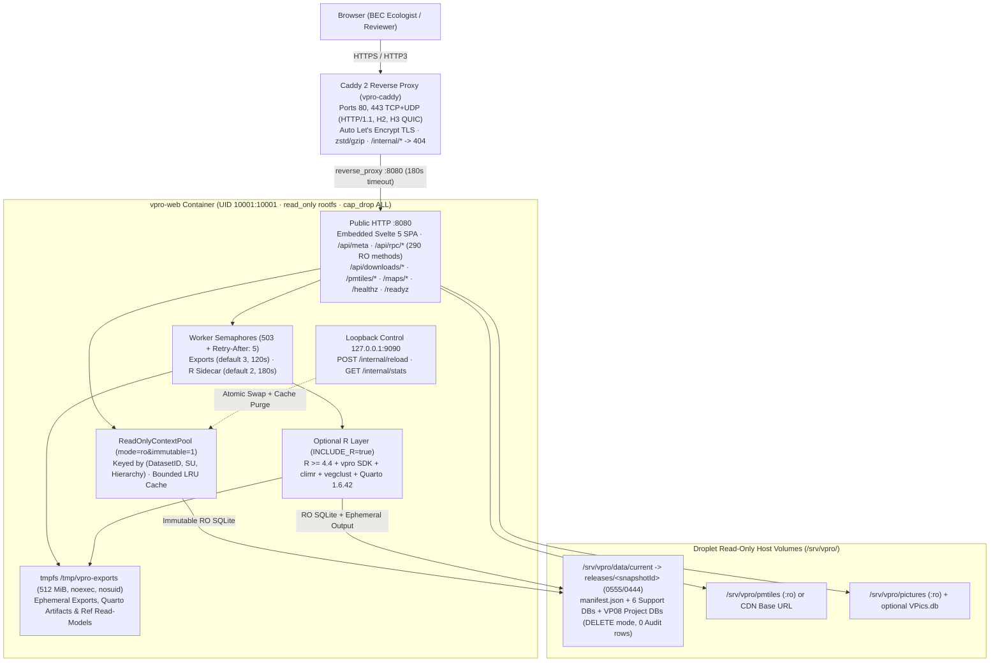

# Read-Only Web Server & Snapshot Deployment Runbook (`vpro-web` & `vpro-snapshot`)

> **Navigation:** [Master Index](../00_index.md) | **Engineering & Agents:** [Desktop App Engineering](./desktop_app_engineering.md) · [R SDK Engineering](./r_sdk_engineering.md) · `Web Read-Only Deployment` | **Related:** [System Architecture](../02_present_state/system_architecture.md) · [Decisions & Gaps (`D-14`)](../04_evidence_and_sources/decisions_and_gaps.md)

---

## 1. Architecture Overview

**`vpro-web`** is VPro 2.0's third delivery surface: a pure-HTTP, stateless, read-only web viewer and analytical server for immutable **`BECMaster`** / `VP08` SQLite snapshots, sized for **~4–5 peak concurrent (~20 weekly) BEC ecologists** on a single DigitalOcean Droplet.



### Key Hardening & Build Properties
- **Headless Go Binaries (`-tags vpro_headless`):** Built in [`deploy/vpro-web/Dockerfile`](../../deploy/vpro-web/Dockerfile) with `CGO_ENABLED=1` (`go-sqlite3` only) and **zero** Wails v3, GTK/WebKit, or `accessreader` (`libmdb`) transitive dependencies (enforced by [`app/cmd/vpro-web/deps_headless_test.go`](../../app/cmd/vpro-web/deps_headless_test.go)). Both `/usr/local/bin/vpro-web` and `/usr/local/bin/vpro-snapshot` ship in the container image.
- **Strict 290-Method Read-Only RPC Allowlist:** Every `/api/rpc/<Service>/<Method>` call is gated against [`app/resources/web_rpc_allowlist.json`](../../app/resources/web_rpc_allowlist.json) (`290` methods across `12` services: `220` `rpc`, `20` `download`, `50` `prefs`). Build-time verification (`node scripts/generate-web-rpc-map.mjs --check`) and startup bijection checks in [`app/cmd/vpro-web/rpc_router.go`](../../app/cmd/vpro-web/rpc_router.go) guarantee that zero mutation endpoints exist.
- **Zero-Write / Zero-Audit Container Posture:** Container runs as non-root `10001:10001` with `read_only: true`, `cap_drop: [ALL]`, `no-new-privileges:true`, and `tmpfs` mounts for `/tmp` (`64 MiB`) and `/tmp/vpro-exports` (`512 MiB`, `noexec,nosuid`). Published SQLite databases have `0` rows in `<Project>_Audit` and open strictly with `mode=ro&immutable=1`. Session preferences stay in memory (`NewInMemoryDesktopConfig`) with zero server-side persistence.
- **Two Container Image Flavors (`INCLUDE_R` Build Arg):**

| Build Option | Approximate Image Size | Capabilities | When to Use |
|---|---:|---|---|
| **`INCLUDE_R=true`** *(default)* | ~1.4–1.8 GB | Full read-only viewer, maps, `.xlsx`/`.gpkg`/`.rds`/TurboVeg 3 exports **plus** out-of-process R sidecar (`vpro` SDK, `climr -> aSMR`, `vegclust`, `vegan`, Quarto `1.6.42` HTML/PDF guides) | Standard **`dev`** and **`prod`** deployments |
| **`INCLUDE_R=false`** | ~55 MB | Full read-only viewer, maps, diagnostics, and Go-native exports; sets `VPRO_RSCRIPT_PATH=none` & `VPRO_QUARTO_PATH=none` (R sidecar endpoints gracefully report unavailable) | Ultra-lean viewer-only deployments or constrained hosts |

---

## 2. DigitalOcean Droplet Provisioning Checklist

Complete these steps once logged into DigitalOcean before triggering the first GitHub Actions deploy for `dev` or `prod`.

### 2.1 Droplet Sizing & OS
- **OS Image:** Ubuntu 24.04 LTS (`linux/amd64`).
- **Region:** Toronto (`tor1`, Canadian data residency) or San Francisco (`sfo3`, lowest West Coast latency to BC).
- **Recommended Sizing:**
  - **`prod` (with `INCLUDE_R=true` + OS page cache for 545 MB `BECMaster` SQLite):** **2 vCPU / 4 GB RAM** minimum (80 GB NVMe/SSD; upgrade to **4 vCPU / 8 GB RAM** if sustained R `climr`/`vegclust` concurrency grows). Set `VPRO_MEM_LIMIT=3g`–`4g` and `VPRO_CPUS=1.5`–`3.0` in `.env` so the host OS retains RAM for SQLite page caching.
  - **`dev` (staging / reviewer preview):** **1–2 vCPU / 2 GB RAM** (50 GB SSD; `2 vCPU / 2–4 GB RAM` recommended when exercising `INCLUDE_R=true`). Default `.env` sets `VPRO_MEM_LIMIT=2g` and `VPRO_CPUS=1.5`.
- **Disk Budget:** Plan for ~3× snapshot size (default `--keep 3` retained releases) plus optional provincial `PMTiles` archives and plot pictures.

### 2.2 DNS Records (Configure Before First Caddy Start)
Create DNS records pointing to the Droplet's public IP before starting Caddy so automatic Let's Encrypt ACME certificate issuance succeeds immediately:
- `A` record: `becmaster-dev.<your-domain>` $\rightarrow$ `<dev-droplet-ipv4>` (and `becmaster.<your-domain>` $\rightarrow$ `<prod-droplet-ipv4>`).
- `AAAA` record *(if IPv6 enabled on the Droplet)*: matching Droplet IPv6 address.

### 2.3 Firewall Rules (Strict Minimal Exposure)
Apply via DigitalOcean Cloud Firewall (and optionally `ufw` on the host):

| Port / Protocol | Direction | Exposure | Purpose |
|---|---|---|---|
| **TCP `80`** | Inbound | Public (`0.0.0.0/0`, `::/0`) | Let's Encrypt ACME HTTP-01 + automatic HTTP $\rightarrow$ HTTPS redirect |
| **TCP `443`** | Inbound | Public (`0.0.0.0/0`, `::/0`) | HTTPS (HTTP/1.1 & HTTP/2) served by Caddy |
| **UDP `443`** | Inbound | Public (`0.0.0.0/0`, `::/0`) | HTTP/3 (QUIC) served by Caddy |
| **TCP `22`** | Inbound | Restricted (admin + CI SSH) | SSH administration & GitHub Actions deployment |
| **TCP `9090`** | **BLOCKED** | **Host loopback `127.0.0.1` ONLY** | `vpro-web` `/internal/reload` & `/internal/stats` — **never expose publicly** |
| **TCP `8080`** | **BLOCKED** | Internal Docker bridge only | `vpro-web` app port (reached exclusively via Caddy) |

> [!CAUTION]
> **Port `9090` MUST remain loopback-only (`127.0.0.1:9090:9090` in [`deploy/vpro-web/docker-compose.yml`](../../deploy/vpro-web/docker-compose.yml)).** Never open TCP `9090` in DigitalOcean Cloud Firewall or UFW. As defense-in-depth, [`deploy/vpro-web/Caddyfile`](../../deploy/vpro-web/Caddyfile) also returns HTTP `404` for all `/internal/*` paths.

### 2.4 Host Bootstrap (Docker, Deploy User & Directory Layout)
Run once on the provisioned Ubuntu 24.04 Droplet:

```bash
# 1. Install Docker Engine + Docker Compose v2 plugin (official Docker apt repo)
curl -fsSL https://get.docker.com | sudo sh
sudo systemctl enable --now docker

# 2. Create a dedicated non-root deploy user in the docker group
sudo useradd --create-home --shell /bin/bash deploy
sudo usermod -aG docker deploy
sudo install -d -m 0700 -o deploy -g deploy /home/deploy/.ssh
# Add the public key corresponding to GitHub secret DO_SSH_KEY into /home/deploy/.ssh/authorized_keys
# sudo chmod 0600 /home/deploy/.ssh/authorized_keys && sudo chown deploy:deploy /home/deploy/.ssh/authorized_keys

# 3. Create the canonical /srv/vpro host directory layout
sudo mkdir -p /srv/vpro/deploy /srv/vpro/data/releases /srv/vpro/pmtiles /srv/vpro/pictures
sudo chown -R 10001:10001 /srv/vpro/data /srv/vpro/pmtiles /srv/vpro/pictures
sudo chown -R deploy:deploy /srv/vpro/deploy
```

> [!NOTE]
> **Deploy Directory Alignment:** [`.github/workflows/web-deploy.yml`](../../.github/workflows/web-deploy.yml) defaults `DO_DEPLOY_DIR` to `/opt/vpro-web` when the secret is unset. To keep all runtime files consolidated under `/srv/vpro/deploy`, set the GitHub Environment secret `DO_DEPLOY_DIR=/srv/vpro/deploy` (or create `/opt/vpro-web` owned by `deploy:deploy` if using the default).

```bash
# 4. Seed .env in your chosen deploy directory from deploy/vpro-web/env.example
#    and set VPRO_ENV, VPRO_DOMAIN, VPRO_IMAGE, VPRO_MEM_LIMIT, VPRO_CPUS
cp env.example /srv/vpro/deploy/.env
chmod 0640 /srv/vpro/deploy/.env
```

- **Optional Basic Auth for Non-Public `dev`:** Uncomment the `@protected` / `basic_auth` block in [`deploy/vpro-web/Caddyfile`](../../deploy/vpro-web/Caddyfile) (leaving `/healthz` and `/readyz` unauthenticated for CI health checks) using `docker compose exec caddy caddy hash-password --plaintext 'CHANGE_ME'`. Note that CI copies `deploy/vpro-web/Caddyfile` on deploy, so keep persistent `dev` auth configuration either in a tracked environment-specific branch/override or via a host-managed Caddy include if required.
- **Cold-Start Snapshot Prerequisite:** Publish and activate at least one verified snapshot bundle via `sync-snapshot.sh` so `/srv/vpro/data/current` exists before the first `docker compose up -d` (Docker bind-mounts `/srv/vpro/data/current` read-only at `/data` and `/srv/vpro/data` read-only at `/srv/vpro/data`).

---

## 3. GitHub Environments & Secrets Checklist

[`.github/workflows/web-deploy.yml`](../../.github/workflows/web-deploy.yml) builds `linux/amd64` container images to `ghcr.io/<owner>/<repo>/vpro-web` and deploys over SSH with automatic `/readyz` rollback.

### 3.1 Trigger & Environment Routing
- **Push to `main`** (changing `app/**`, `r/**`, `deploy/vpro-web/**`, or `.github/workflows/web-deploy.yml`): builds & pushes `:dev-<short_sha>` + `:dev`, then deploys to GitHub Environment **`dev`**.
- **Git tag `web-v*`** (e.g., `web-v1.0.0`): builds & pushes `:web-v*` + `:latest`, then deploys to GitHub Environment **`prod`**.
- **Manual `workflow_dispatch`:** Choose `environment` (`dev` | `prod`), optional existing GHCR `image_tag` (skips rebuild), and `include_r` (`true` default | `false` for ~55 MB Go-only image).
- **Graceful Skip Gate:** If `DO_HOST`, `DO_USER`, or `DO_SSH_KEY` is not yet set on the target environment, the build/push still succeeds and the SSH deploy step skips cleanly with a reminder in the job summary.
- **Recommended GitHub Environment Protection (`prod`):** Require at least 1 reviewer approval on the `prod` GitHub Environment and restrict deployments to `web-v*` tags / protected branches.

### 3.2 Exact Secrets Per Environment (`dev` and `prod`)

| Secret Name | Required | Example Value / Notes |
|---|---|---|
| **`DO_HOST`** | **Yes** | Droplet public IPv4 or FQDN (e.g., `203.0.113.10` or `becmaster-dev.example.com`) |
| **`DO_USER`** | **Yes** | Non-root SSH user in `docker` group (e.g., `deploy`) |
| **`DO_SSH_KEY`** | **Yes** | Dedicated Ed25519 private key (PEM/OpenSSH format) authorized on the Droplet |
| **`DO_DEPLOY_DIR`** | Optional | Remote directory holding `docker-compose.yml`, `Caddyfile`, `sync-snapshot.sh`, and `.env` (defaults to `/opt/vpro-web`; set `/srv/vpro/deploy` to match the `/srv/vpro/` layout) |
| **`VPRO_HEALTHCHECK_URL`** | Optional | External readiness URL verified after deploy (e.g., `https://becmaster-dev.example.com/readyz` or `https://becmaster.example.com/readyz`). If omitted, CI probes `http://127.0.0.1:8080/readyz` inside `vpro-web`. |
| **`DO_SSH_KNOWN_HOSTS`** | Optional *(recommended)* | Output of `ssh-keyscan -t ed25519 <DO_HOST>` to enforce `StrictHostKeyChecking=yes` instead of `accept-new` |

### 3.3 GHCR Pull Authentication (Private Repository Note)
- **During CI Deploys:** `web-deploy.yml` authenticates the Droplet to `ghcr.io` using `${{ github.actor }}` + `${{ secrets.GITHUB_TOKEN }}` (`packages: read`).
- **Standalone Droplet Pulls (`sync-snapshot.sh` Cold Bootstrap / Manual Maintenance):** If the `Boostao/vpro` repository or its GHCR package is **private**, run `docker login ghcr.io` once on the Droplet as `deploy` with a fine-grained/classic GitHub PAT scoped strictly to **`read:packages`** so standalone `docker run` (used by `sync-snapshot.sh` when `vpro-web` is not yet running) and manual `docker compose pull` can pull images without CI.

---

## 4. Periodic Snapshot Publishing & Zero-Downtime Refresh Runbook

Snapshots are built **offline** on a custodian workstation or build host from a canonical `VP08` SQLite database (never mutating source `.db` files), verified cryptographically, transferred to the Droplet, and activated with zero downtime.

### 4.1 Build & Verify Immutable Snapshot (Off-Box)
```bash
# Build headless vpro-snapshot CLI from repo root (or run from container image)
(cd app && CGO_ENABLED=1 GOTOOLCHAIN=go1.27.4+auto go build -tags vpro_headless -o ../vpro-snapshot ./cmd/vpro-snapshot)

# 1. Build immutable, redacted snapshot bundle (does NOT mutate --source)
./vpro-snapshot build \
  --source /path/to/BECMaster.db \
  --vlists /path/to/VLists.db \
  --support-dir /path/to/database-family \
  --snapshot-id becmaster-2026-11 \
  --label "BECMaster Provincial Snapshot (Nov 2026)" \
  --out /tmp/becmaster-2026-11

# 2. Verify SHA-256 digests, non-WAL DELETE header (1,1), mode=ro&immutable=1 openability,
#    VP08 schema integrity, 0-row <Project>_Audit, and RedBlueList coordinate redaction
./vpro-snapshot verify --bundle /tmp/becmaster-2026-11

# 3. Package compressed tarball for transfer to the Droplet
tar -C /tmp -czf /tmp/becmaster-2026-11.tar.gz becmaster-2026-11
```

What `vpro-snapshot build` guarantees (`app/cmd/vpro-snapshot/publish.go`, `manifest.go`, `redact.go`):
1. Stages all 6 `VP08` support databases (`VPro64.db`, `VLists.db`, `VUser.db`, `VMetaData.db`, `VMessageBoard.db`, `VPics.db`) and project/auxiliary `.db` files into a clean sibling staging directory.
2. Applies fail-closed `USysSppAttributes.RedBlueList` coordinate truncation (`--redact=true` by default).
3. Strips every `<Project>_Audit` table to **`0` rows**.
4. Finalizes every `.db` file: `PRAGMA wal_checkpoint(TRUNCATE)` $\rightarrow$ `PRAGMA journal_mode = DELETE` $\rightarrow$ `ANALYZE` & `VACUUM` $\rightarrow$ removes any `-wal`/`-shm`/`-journal` sidecars $\rightarrow$ verifies `mode=ro&immutable=1` openability and `PRAGMA quick_check`.
5. Writes deterministic `manifest.json` (`schemaVersion: 1`, `snapshotId`, `publishedAt`, `redacted`, `redactedPlotCount`, `standards`, `supportFiles`, `auxiliaryFiles`, `datasets`) and enforces `0444` files / `0555` directories.

### 4.2 Transfer & Zero-Downtime Activation on the Droplet
```bash
# Transfer tarball to the Droplet
scp /tmp/becmaster-2026-11.tar.gz deploy@<DO_HOST>:/tmp/

# On the Droplet: stage, verify, atomically flip symlink, reload, verify /readyz & prune old releases
ssh deploy@<DO_HOST> \
  '/srv/vpro/deploy/sync-snapshot.sh /tmp/becmaster-2026-11.tar.gz --compose-dir /srv/vpro/deploy --data-root /srv/vpro/data --keep 3'
```

What [`deploy/vpro-web/sync-snapshot.sh`](../../deploy/vpro-web/sync-snapshot.sh) executes atomically:
1. Validates archive paths (rejecting absolute paths and `..` traversal) and reads `snapshotId` from `manifest.json` (refusing to overwrite the currently active release).
2. Enforces `0444`/`0555` permissions and moves the bundle into `/srv/vpro/data/releases/<snapshotId>`.
3. Runs `/usr/local/bin/vpro-snapshot verify --bundle ...` inside the running `vpro-web` container (or via standalone `docker run --rm` during first-time cold bootstrap before `vpro-web` starts). On failure, deletes the staged release and exits without touching `current`.
4. Atomically flips the relative symlink `/srv/vpro/data/current -> releases/<snapshotId>` via `ln -s` + `mv -Tf` (valid identically on the host and inside the `/srv/vpro/data:ro` bind mount).
5. Sends `POST http://127.0.0.1:9090/internal/reload` to swap `ReadOnlyContextPool` to the new catalog generation and purge stale preview caches, then polls `/readyz` for up to 10 seconds.
6. **Automatic Rollback on Reload Failure:** If `/internal/reload` or `/readyz` fails, `sync-snapshot.sh` flips `/srv/vpro/data/current` back to the previous release and re-triggers `/internal/reload`.
7. Prunes inactive releases beyond `--keep 3` (always preserving the active release).

### 4.3 Instant Manual Rollback
Because `--keep 3` retains the last three verified bundles in `/srv/vpro/data/releases/`, rolling back to a previous snapshot takes under 2 seconds without restarting containers:

```bash
# List retained releases and current target
ls -la /srv/vpro/data/releases /srv/vpro/data/current

# Atomically repoint symlink to a retained release and trigger live reload
ln -s "releases/<previous-snapshot-id>" /srv/vpro/data/.current.rollback
mv -Tf /srv/vpro/data/.current.rollback /srv/vpro/data/current
curl -fsS -X POST http://127.0.0.1:9090/internal/reload
curl -fsS http://127.0.0.1:9090/readyz
```

---

## 5. Client Sign-Off Gate: Fail-Closed `RedBlueList` Coordinate Redaction

Consistent with `app/internal/cloudsync` and [`D-12` / `D-14`](../04_evidence_and_sources/decisions_and_gaps.md), **`vpro-snapshot build` enforces BC Conservation Data Centre (CDC) rare-plant coordinate redaction fail-closed by default (`--redact=true`)**:

- **Detection Rule (`app/cmd/vpro-snapshot/redact.go`):** Loads `USysSppAttributes.RedBlueList` from `VLists.db` (skipping synonym rows with `Codetype = 'S'`). If `VLists.db` lacks `USysSppAttributes` or required columns, `build` and `verify` **fail closed**.
- **Truncation Applied:** For every plot containing a Red- or Blue-listed taxon in `<Project>_Veg`, all six `_Env` coordinate columns (`Latitude`, `Longitude`, `UTMEasting`, `UTMNorthing`, `XCoord`, `YCoord`) are truncated to **`0.1°` (~10 km)** lat/lon and **`10,000 m`** UTM grid precision.
- **Manifest & Verification:** `manifest.json` records `"redacted": true` and exact per-dataset and total `redactedPlotCount`. `vpro-snapshot verify` re-scans every published project database to guarantee zero unredacted sensitive coordinates remain and exact `redactedPlotCount` parity.
- **Explicit Double-Gate Opt-Out (Requires Written Client Sign-Off):**
  - Passing `--redact=false` alone is **rejected** with an error.
  - Publishing unredacted coordinates requires passing **both** flags explicitly:
    ```bash
    ./vpro-snapshot build --source ... --out ... --redact=false --confirm-unredacted
    ```
  - **Policy Gate (`D-14`):** Keep `--redact=true` on all public or semi-public deployments until B.C. Ministry of Forests (Will MacKenzie) provides written sign-off confirming whether `prod` must remain redacted or whether an authenticated internal deployment may publish unredacted coordinates.

---

## 6. Runtime Configuration & Operational Diagnostics

### 6.1 Core `VPRO_WEB_*` Knobs ([`app/cmd/vpro-web/config.go`](../../app/cmd/vpro-web/config.go) & [`deploy/vpro-web/env.example`](../../deploy/vpro-web/env.example))

| Variable | Default | Purpose |
|---|---|---|
| `VPRO_WEB_ENV` | `dev` | Deployment environment label (`dev` or `prod`) exposed in `/api/meta` |
| `VPRO_WEB_DATA_DIR` | `/srv/vpro/data/current` *(Compose)* | Active immutable snapshot directory (required unless `--dev-sample` is passed) |
| `VPRO_WEB_R_CONCURRENCY` / `VPRO_WEB_R_TIMEOUT` | `2` / `180s` | Bounded R sidecar semaphore & per-job timeout (`503` + `Retry-After: 5` when saturated) |
| `VPRO_WEB_EXPORT_CONCURRENCY` / `VPRO_WEB_EXPORT_TIMEOUT` | `3` / `120s` | Bounded `.xlsx`/`.gpkg`/`.rds`/TurboVeg 3 export semaphore & timeout |
| `VPRO_WEB_POOL_SLOTS` / `VPRO_WEB_MAX_POOLS` | `6` / `16` | Read-only SQLite connection slots per `(Dataset, SU, Hierarchy)` key & max pooled keys |
| `VPRO_WEB_CACHE_MAX_MB` | `256` | Bounded in-memory LRU preview/summary response cache budget (MiB) |
| `VPRO_WEB_PMTILES_DIR` / `VPRO_WEB_PMTILES_CDN_BASE_URL` | `/pmtiles` / *(empty)* | Local read-only `PMTiles` directory or external CDN/Spaces base URL |

### 6.2 Health, Readiness & Loopback Inspection Commands
```bash
# Public liveness, readiness, and published snapshot/standards metadata
curl -fsS https://<VPRO_DOMAIN>/healthz
curl -fsS https://<VPRO_DOMAIN>/readyz
curl -fsS https://<VPRO_DOMAIN>/api/meta

# Loopback-only operational stats (pool slots, reload count, cache usage, in-flight export/R counts)
curl -fsS http://127.0.0.1:9090/internal/stats

# Container logs & health status
docker compose -f /srv/vpro/deploy/docker-compose.yml ps
docker compose -f /srv/vpro/deploy/docker-compose.yml logs --tail=100 vpro-web caddy

# Local developer smoke test (no external BECMaster snapshot required)
(cd app && CGO_ENABLED=1 GOTOOLCHAIN=go1.27.4+auto go run -tags vpro_headless ./cmd/vpro-web --dev-sample)
```
