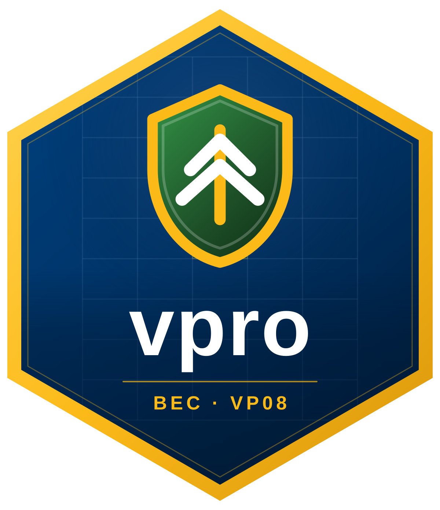

# vpro 2.0: Companion R SDK & Quantitative Ecology Engine for VPro <a href="https://boostao.github.io/vpro/r/"></a>

`vpro` is the headless R companion package and scientific analytics engine for **`VPro`** (`app/` in [`Boostao/vpro`](https://github.com/Boostao/vpro)) under the British Columbia Ministry of Forests **Biogeoclimatic Ecosystem Classification (BEC)** Program.

## Installation

```r
# Recommended via pak (monorepo r/ subdirectory):
pak::pak("Boostao/vpro/r")

# Or via remotes:
remotes::install_github("Boostao/vpro", subdir = "r")
```

- **VPro Desktop Portal & Downloads:** <https://boostao.github.io/vpro/>
- **R SDK Reference & Vignettes:** <https://boostao.github.io/vpro/r/>

Interactive plot-card data entry, datasheet editing, and 3D MapLibre/WebGPU spatial inspection live in the desktop `VPro` application; `vpro` gives quantitative ecologists and data custodians direct, WAL-safe programmatic access to the local 7-database `VP08` SQLite workspace, portable zero-database `.rds` project snapshots, and the provincial PostgreSQL **`BECMaster`** service (`becmaster`, `staging`, and `standards` schemas) from R, Quarto, and `_targets`.

## Quick Start

```r
library(vpro)

# Connect to the live vpro_wails workspace (or bundled 2026 Sample workspace)
con <- vpro_sample()

# Extract tidy environment, lumped vegetation, and LMH25-ordered soil horizons
env  <- vpro_env(con, exclude_modifiers = TRUE)
veg  <- vpro_veg(con, strata = "total", lump = TRUE)
soil <- vpro_soil(con)

# Build a vegan-ready plot x species community matrix with row-aligned env metadata
mat <- vpro_matrix(con, transform = "sqrt")

# Run fuzzy noise clustering and round-trip candidate units back to VPro
cl <- vpro_cluster(con, method = "vegclust_nc", k = 4)

# Compute BEC diagnostics, climate/aSMR, and dual 9x5 edatopic grids
diag_res <- vpro_diagnostics(con)
asmr_df  <- vpro_asmr(con, force_offline = TRUE)
ed       <- vpro_edatopic_grid(con, mode = "dual", force_offline = TRUE)
plot_edatope(ed)
```

## Portable `.rds` Project Snapshots

Archive any `VP08` workspace—or open `.rds` project exports from `vpro_wails`—as a self-contained, zero-database `vpro_workspace` with full `BECdb v13`, `BCPlantTaxonomy v19`, and audit-hash provenance:

```r
snap_file <- tempfile("bec-snapshot-", fileext = ".rds")
vpro_write_rds_snapshot(con, dest_path = snap_file, snapshot_tag = "Sample_2026")

rds_ws <- vpro_read_rds_project(snap_file)
vpro_diagnostics(rds_ws, min_constancy = 50)
```

## Cloud `BECMaster` Queries, Contributor Staging, and Custodian Merge

When PostgreSQL `BECMaster` credentials (`VPRO_PG_*` or `becmaster.env` in `vpro_config_dir()`) are configured, contributors and provincial custodians can query `becmaster.*`, check out `REPEATABLE READ` regional `VP08` SQLite splinters, stage validated plot edits, execute 3-way `SERIALIZABLE` merges with custodian-protected `Admin` field guards (`BECSiteUnit`, `BEC_Use`, `GIS_BGC`), and publish multi-format releases:

```r
if (vpro_has_pg_credentials("contributor")) {
  pg <- vpro_master_connect(role = "contributor")

  # Push-down cloud queries & self-cleaning analytical workspaces
  cwh_env  <- vpro_master_env(pg, zones = "CWH", subzones = "vm1")
  ws_cloud <- vpro_master_workspace(pg, zones = "CWH", subzones = "vm1")
  vpro_master_verify_audit(pg, limit = 500)$valid

  # Regional VP08 SQLite checkout & pre-flight-validated staging submission
  splinter <- vpro_master_pull(pg, "CWHvm_2026.db", "CWHvm_2026", zones = "CWH", subzones = "vm1")
  vpro_staging_submit(pg, splinter$workspace, submitter = "Regional Ecologist")

  vpro_master_disconnect(pg)
}
```
